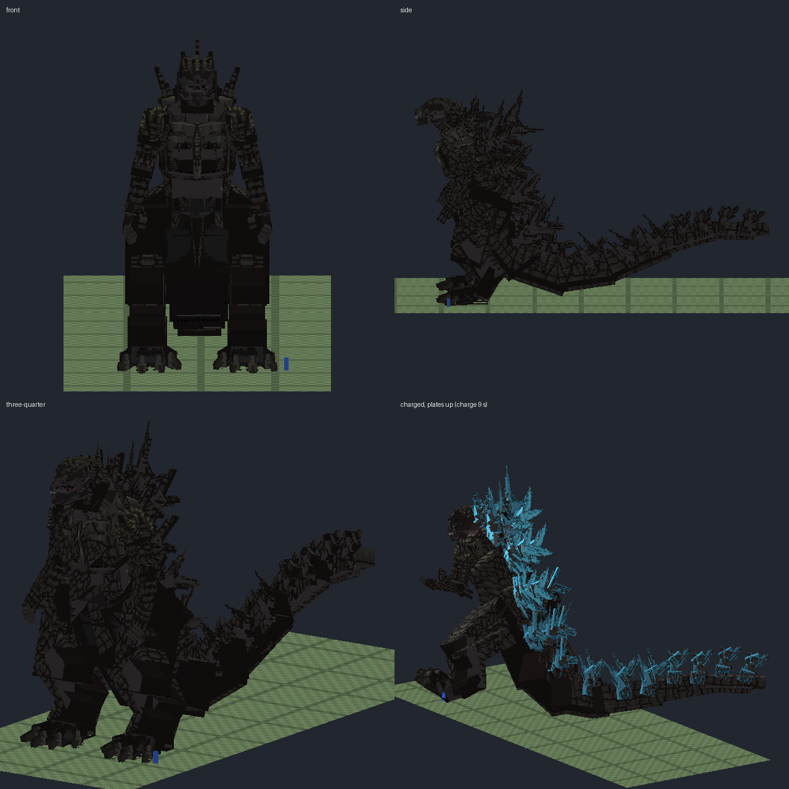
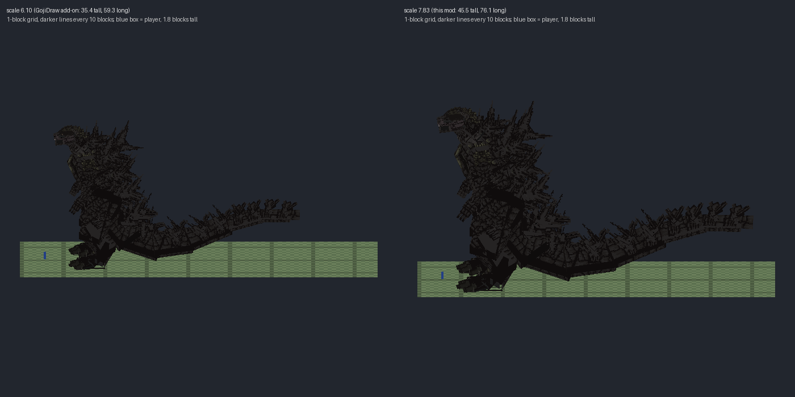
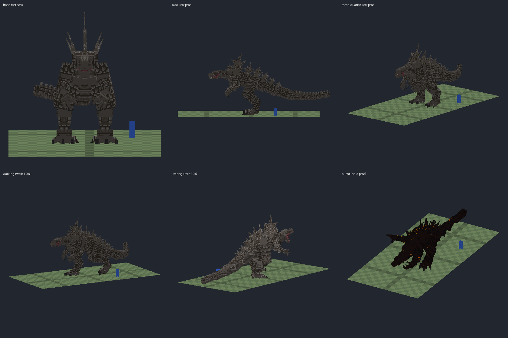

# Godzilla Minus One — Forge 1.20.1

A Minecraft Java Edition (Forge 1.20.1, GeckoLib 4) port of the Bedrock add-on
**"Godzilla Minus One" V3 by GojiDraw**. Godzilla is the add-on's own model, textures and animations, exactly
(scaled up evenly to stand 10 blocks taller), and so are the Shinden, naval mine, sounds and effects. The atomic
blast's mushroom cloud is **Alex's Caves'** orange nuclear mushroom cloud, ported. The mod also adds the **Odo
Island Monster** (Godzilla's smaller, dinosaur-like form from the start of the film): Monster122's
**Godzillasaurus** from the "G-1" Bedrock add-on, with its own model and animations. There are also the **Shinsei
Maru**, the film's little minesweeper with its stern machine gun and a hold of naval mines, a **searchlight**, a
**nuclear bomb**, a **remote detonator** for the naval mines, and posed **Godzilla statues** for screenshots and
thumbnails.



*GojiDraw's Godzilla from the front, side and three-quarters, and charged (his plates up and glowing icy cyan).
Offline renders on a one-block grid (darker lines every 10 blocks); the small blue box is a player, 1.8 blocks
tall.*



*The add-on draws him 6.1x (35.4 blocks tall, 59.3 long); the mod 7.83x, evenly (45.5 tall, 76.1 long).*



*The Odo Island Monster (Monster122's Godzillasaurus, his hide turned grey and brown): front, side and
three-quarters, walking, roaring, and burnt to a crisp by a nuclear bomb. Same grid and player as above.*


*The Shinsei Maru: the wheel up on the wheelhouse roof, cages on the foredeck, a rack of recovered naval mines
astern, and the Type 93 machine gun on the stern platform pointing aft. Offline renders on a one-block grid, with
a player.*


*The thumbnail statues: charging roar (its tail plates glow in game), tail whip, roar to the sky.*


*The atomic blast's mushroom cloud, Alex's Caves' (its model, textures and animation, 240 blocks tall here):
the white-hot fireball, the mushroom bursting out of it, the full cap over the fiery plume with the rings spreading,
the glow cooling to smoke, and the fade at the end (0.25, 1, 5, 20, 40 and 59.5 s), from the side, three-quarters,
below, above and far away. Offline renders of the same model and passes (tools/preview_cloud.py), over 20-block
squares; the red post is Godzilla's height. The fiery puffs are drawn as plain blobs there.*

## Requirements

- Minecraft 1.20.1 with Forge 47.x
- [GeckoLib](https://www.curseforge.com/minecraft/mc-mods/geckolib) 4.x for 1.20.1 (4.8.4 tested against)
- Optional: [AttributeFix](https://www.curseforge.com/minecraft/mc-mods/attributefix), only if you raise
  Godzilla's max health above 1024 in the config

## What's in it

| Add-on content | In this mod |
| --- | --- |
| `goji:gojira` (+ dead / spawn stages) | **Godzilla** (`godzillaminusone:godzilla`), one entity with emerge → roar → active → collapse → dead → regenerate phases |
| `goji:kyushu_j7w1` | **Kyushu J7W1 Shinden**, a fighter you can fly |
| `goji:torrid` | **Torrid**, the Shinden's cannons: right-click while flying it |
| `goji:mine_spawn` / `goji:mine` | **Naval Mine**, craftable (4 netherite ingots, 4 netherite blocks, TNT in the middle), and a **Remote Detonator** for it |
| `goji:nuclear_hole` | The crater and blast wave left by the atomic breath |
| Nuclear explosion particles | The flash, shockwaves and black rain as particles; the mushroom cloud is Alex's Caves' (`client/render/NuclearCloud.java`, `MushroomCloudModel.java`) |
| Particles, camera shakes, custom boss bar | Recreated in Java (see `client/`); the fade to black is a blur instead |
| *(from Monster122's G-1 add-on)* | **Odo Island Monster** (`godzillaminusone:odo_island_monster`), with its spawn egg |
| *(new, from the film)* | **Shinsei Maru**, the minesweeper: a boat with a stern machine gun and a hold of naval mines |
| *(new)* | **Searchlight**, a mountable WWII searchlight |
| *(new)* | **Nuclear Bomb**, called in from the sky |
| *(new)* | **Godzilla statues** in three poses, `/summon` only |

### Godzilla

- GojiDraw's model, 45.5 blocks tall, 21.7 wide and 76 long (tail and dorsal plates included). Spawns from
  his egg by rising out of the ground and roaring, then becomes active (with the add-on's boss bar).
- **His roar carries for 3000 blocks**: faint that far off, louder at 2000, louder again at 1000, and so on as
  you get closer (loud, but not painful in headphones).
- **Radiation aura**: anything within 16 blocks gets "RADIATION POISONING" and Wither.
- Every footfall shakes the camera, hurts everything near him and **crushes a footprint** of rubble into the
  ground. He smashes through blocks (needs `mobGriefing`).
- **He knocks down tall buildings**: when there's nothing in sight for him to kill and he sees anything built
  standing **half his height (23 blocks) or more** above the ground (within 64 blocks), he goes over and swipes
  at it, ten layers at a time, until it's down to **a quarter of his height (11 blocks)**, then leaves it alone.
  Trees and hills don't count. A mob turning up sends him after it instead.
- **He roars every 2 minutes** (stopping where he is to do it); set how often in the config screen.
- Up close he attacks in a combo: a **claw swipe with each hand**, then a **heavy spin** of his whole body with
  the tail sweeping round him and **snapping like a whip**. He bites at things above him, stomps on things
  under his feet, and swings the tail round at anything behind him.
- For the first **2 to 3 minutes after he appears** he can't use his atomic breath yet.
- With a target he **charges his atomic breath**: the dorsal plates light up blue one by one from the tail to
  the neck as they punch up, mobs freeze in fear, he breathes in for 4 seconds (the in-breath sound lasts
  exactly as long), then rears his head up above his chest and fires (he tilts it further up at planes). The
  beam pours out of his open mouth, which blazes blue while it lasts. **Two seconds after the beam lands**, a
  **nuclear blast** goes off there: it kills everything around it, blasts out a large crater, and a mushroom
  cloud (Alex's Caves') bursts out of a white-hot fireball: a fiery plume rising under a broad dark cap, low
  smoke spreading over the ground, rings racing outwards, the glow cooling to smoke; it grows to 240 blocks and
  hangs there for a minute (both in the config screen). Everyone nearby sees a blur, then black rain falls around ground
  zero (just particles: the weather isn't changed).
- The blast **levels the land for 140 blocks around**: everything above **Y 65** (trees, grass, buildings,
  hills) is obliterated, sweeping outwards from ground zero, and **nothing drops**. Seas and rivers stay. Parts of
  the area that aren't loaded yet are flattened when they load. Radius and height are in the config.
- He then needs **3 minutes to recharge** before the next breath (change it in the config screen).
- The breath **burns his own mouth**: the flesh round it is left raw, blistered and glowing, smoking and
  spitting embers, then tears and knits back together over 40 seconds.
- **A plane in the air always comes first**: if someone is flying a Shinden, he goes after it.
- He regenerates while calm and likes to wander into water. In shallow water he walks along the bottom; in deep
  water he **swims at the surface** with his dorsal plates out of the water, runs down boats and bites at them
  (a new swimming bite, he doesn't stand up). Every 10 seconds his **head comes up out of the water** and
  glares around for 4 seconds, then sinks back under.
- **Only naval mines hurt him** (as in the add-on), each taking about 10% of his health and stunning him.
  At zero health he collapses, lies dead for 15 seconds, then regenerates and rises again.

### Kyushu J7W1 Shinden

- Right-click to climb in. **W** accelerates, **S** brakes, the mouse steers: look up to climb, down to dive.
  The plane noses up as it climbs and down as it dives, stays level in level flight, and banks into turns.
- You stay in the cockpit however it pitches and banks. **Right-click fires the plane's cannons** straight
  ahead: **one shot per click** (one bang, one flash from each gun; holding the button doesn't keep firing),
  whatever you're holding.
- Pilots have the add-on's "plot armour": Godzilla's blasts barely scratch them.
- Fly within 15 blocks of Godzilla and the plane detonates like a naval mine (the film's ending), and you bail
  out with Slow Falling as a parachute.
- Crash into something at (near) full speed and it explodes on impact as big as **3 TNT** (a block-breaking
  explosion of power 12). You bail out and the explosion spares you. The blocks it blows up simply vanish:
  nothing drops, so the game doesn't slow down under a heap of items.
- Hit it like a boat: it rocks, and a few hits knock it back into its item (one hit in creative).
- **Multiplayer servers**: set `allow-flight=true` in `server.properties`, or flying players get kicked.

### Naval Mine

- Floats on water; can be leashed and towed.
- Hitting it by hand (or with a tool) doesn't hurt it: it rocks with a clank, and **four hits knock it loose**
  into its item so you can pick it back up (one hit in creative).
- Anything else that damages it sets it off: arrows, explosions, fire, Godzilla's footsteps, his radiation.
- **Remote Detonator** (a lightning rod on top as the antenna / iron ingot, redstone, iron ingot / iron ingot,
  stone button, iron ingot): point it at a naval mine up to 160 blocks away and right-click, and it goes off.
  Blast radius 30: stand well back.

### Odo Island Monster

- Godzilla's first form from Odo Island: Monster122's Godzillasaurus, **14 blocks tall** and 29 long, 600
  health. Crouched and leaning forward on huge bent legs, head held low in front on a thick curved neck, clawed
  hands hanging, a long tail behind, jagged plates rising high over his back, and a grey and brown scaly hide.
  His walk, roar, two bites (one with a swipe of his arm), stomp and burnt pose are the add-on's animations.
- Left alone he wanders and ignores you, but get within about 16 blocks and he **charges**: he runs you down,
  crashing through trees and fences, and **bites** or **stomps** you.
- **Spotted, he goes into a frenzy**: caught in a searchlight's beam, seen by a player (a player looking at him
  from up to 64 blocks away, or one he can see within 32), or hurt by one, he roars and comes for them: a third
  faster, biting and stomping 60% harder and twice as often, crashing through wooden doors too, and he
  doesn't let up for 90 seconds, even when they're out of sight.
- **Nuke him** with a Nuclear Bomb and he doesn't die: he collapses, **burnt to a crisp**, the embers in his
  hide slowly going out. Nothing can hurt him while he lies there. **Three minutes later he rises again as
  Godzilla.** (Godzilla's own atomic breath just kills him.)

### Searchlight

- Crafted from iron ingots, glass, a redstone lamp and iron blocks (iron ingot, glass, iron ingot / iron
  ingot, redstone lamp, iron ingot / three iron blocks). Right-click the ground to set it up facing the way
  you look.
- Right-click it to sit at it: the lamp turns and tilts with where you look, and while you're manning it the
  beam is lit, reaching 160 blocks. It widens as it goes and lights up **a wide pool** where it lands: a bright
  spot 10 to 25 blocks across (wider the further it reaches) on whatever it hits, lit by a ring of light
  sources up to 7 blocks out. Sneak to get off.
- Hit it like a boat to knock it back into its item.

### Shinsei Maru

- The film's small, run-down wooden minesweeper, about 13.5 blocks long. Crafted from a boat with five dark oak
  planks under it and an iron ingot on top (iron ingot in the top middle / planks, boat, planks / three planks).
  Use it on water to put her in, facing the way you look.
- **Right-click to board.** The first aboard takes the **wheel**, up on the wheelhouse roof: **W/S** throttle,
  **A/D** steer. Flat out she's **as fast as Godzilla swims** after something (8.4 blocks a second). The second
  aboard mans the **Type 93 13 mm machine gun** on the stern platform.
- **The gun points aft** and swings 135 degrees either way: its gunner (or the helmsman, sailing alone) aims it
  by looking and **fires one round per right-click**. A round **sets off a naval mine** it hits.
- **Naval mines**: sneak and right-click her to open her **hold** (9 slots, naval mines only), or right-click her
  with a naval mine in hand to load it. Up to three show in the rack on deck. The helmsman presses **R** ("Drop
  Naval Mine" in Controls) to **drop one over the stern**: it floats there, and goes off when Godzilla comes near
  (his radiation sets it off), like the film's mine dragged into his mouth.
- Hit her like a boat to knock her back into her item, mines and all (one hit in creative). Explosions and
  Godzilla smash her to matchwood, throwing the crew in the water.

### Nuclear Bomb

- Crafted from netherite ingots in the corners, TNT on the sides and a nether star in the middle.
- Use it while looking at a spot up to 256 blocks away: a bomb is dropped from high above it, marked by a red
  flare and a column of smoke. Everyone nearby gets a countdown and hears an **air-raid siren**, the only
  sound until it lands; it **falls for 20 seconds**, then goes off like Godzilla's atomic blast (same kill radius, radiation, crater and
  mushroom cloud; see the atomic blast options in the config). It goes off early if it hits something on the
  way down, such as a roof. Stand well back: the kill radius is 64 blocks by default.

### Godzilla statues (for thumbnails)

Godzilla frozen in poses from the film's posters. They never spawn on their own and have no spawn egg: make
them with `/summon`. A new statue turns to face you; it holds still (in mid-air too), does nothing and can't be
hurt. Hit it in creative mode, or `/kill` it, to remove it.

| Pose | Command |
| --- | --- |
| Roaring, one arm flung out, the glowing tail raised high round his side | `/summon godzillaminusone:godzilla_pose_charging_roar` |
| The tail swung round in front of him, its tip rising | `/summon godzillaminusone:godzilla_pose_tail_whip` |
| Roaring up at the sky, arms spread | `/summon godzillaminusone:godzilla_pose_sky_roar` |

To face a statue a given way, give it a rotation, e.g. `/summon godzillaminusone:godzilla_pose_sky_roar ~ ~ ~ {Rotation:[180f,0f]}`.

## Configuration

- **In game**: Mods → Godzilla Minus One → Config.
  - **Godzilla Health Bar** turns his health bar at the top of the screen on or off.
  - **Atomic Breath: every** sets how long he takes to recharge his atomic breath, from 10 seconds to 10 minutes
    (3 minutes by default).
  - **Roar: every** sets how often he roars on his own, from 30 seconds to 10 minutes, or off (2 minutes).
  - **Mushroom Cloud Height** (40 to 600 blocks, 240) and **Mushroom Cloud Lasts** (10 seconds to 5 minutes,
    1 minute) size and time the atomic blast's mushroom cloud.

  The health bar and the cloud are saved in `config/godzillaminusone-client.toml`; the breath and roar intervals
  in the gameplay config below, so they apply to worlds played on this computer (a server keeps its own).
- **Gameplay**: `config/godzillaminusone-common.toml`. The add-on's world-ending numbers (2000-block kill
  radius, Wither XXVI) are toned down by default; each option's comment lists the add-on's original value so
  you can restore it. You can also make Godzilla mortal, stop him regenerating, turn off block damage, change
  the atomic breath's flattening (`flattenRange`, `flattenDownToY`), his first breath's delay
  (`firstBreathMinSeconds`, `firstBreathMaxSeconds`), which buildings he knocks down and how far
  (`demolishFromHeight`, `demolishDownToHeight`), or stop him knocking them down at all. (The flattening and
  building settings have new names, so a config file from an earlier version picks up the new defaults.)

## Building

```
./gradlew build
```

The jar ends up in `build/libs/`. GitHub Actions builds it on every push (see the *Actions* tab, artifact
`godzillaminusone-jar`) and then runs the server-side game tests (`./gradlew runGameTestServer`, see
`src/main/java/com/npjt25/godzillaminusone/gametest`).

## Re-converting the add-on assets

`tools/convert_addon.py` regenerates everything under `src/main/resources/assets` from the extracted
`.mcaddon` (models, cleaned-up animations, textures split into skins and glow masks, sounds converted to mono Ogg):

```
pip install pillow numpy imageio-ffmpeg
python3 tools/convert_addon.py path/to/extracted/addon
```

Then make Godzilla's burns, edit the animations, and build the rest:

```
python3 tools/godzilla_burns.py         # the burns round his mouth after the beam (on the add-on's texture layout)
python3 tools/edit_animations.py        # in-breath, beam from the mouth, swimming bite and peek, melee combo, statue poses
python3 tools/make_sounds.py            # the in-breath, the nuclear bomb's air-raid siren, single gunshots (Shinden, Shinsei Maru)
python3 tools/make_odo_model.py "path/to/G-1(RE)"   # the Odo Island Monster, from Monster122's G-1 resource pack (hide greyed)
python3 tools/make_props.py             # the searchlight, nuclear bomb and Shinsei Maru models
python3 tools/make_icons.py             # item icons of the new items
```

The mushroom cloud's textures (`textures/effect/mushroom_cloud*.png`) are Alex's Caves' own, unchanged.

Previews without starting the game: `tools/render_preview.py` renders a cube model with its texture (and any
animation frame, optionally on a one-block grid with a player for scale); `tools/preview_cloud.py` renders the
mushroom cloud (`tools/mushroom_cloud_model.py`, the same model as the game's) at given times and viewpoints.

## Credits

Original Bedrock add-on (models, textures, animations, sounds): **GojiDraw**. The add-on is marked
"Bedrock only"; this port is for personal use. Ask GojiDraw before publishing it anywhere.

The Odo Island Monster is **Monster122**'s Godzillasaurus (model, skins and animations) from the "G-1" Bedrock
add-on.

The atomic blast's mushroom cloud is **Alex's Caves**' (by **AlexModGuy**, GNU LGPL): its model
(`MushroomCloudModel`), rendering and animation (`MushroomCloudParticle`) and fiery puffs (`SmallExplosionParticle`)
adapted to this mod, and its `mushroom_cloud` textures, unchanged.

Godzilla is a trademark of Toho Co., Ltd.
