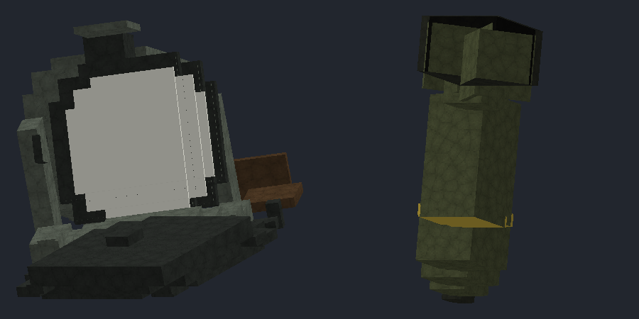
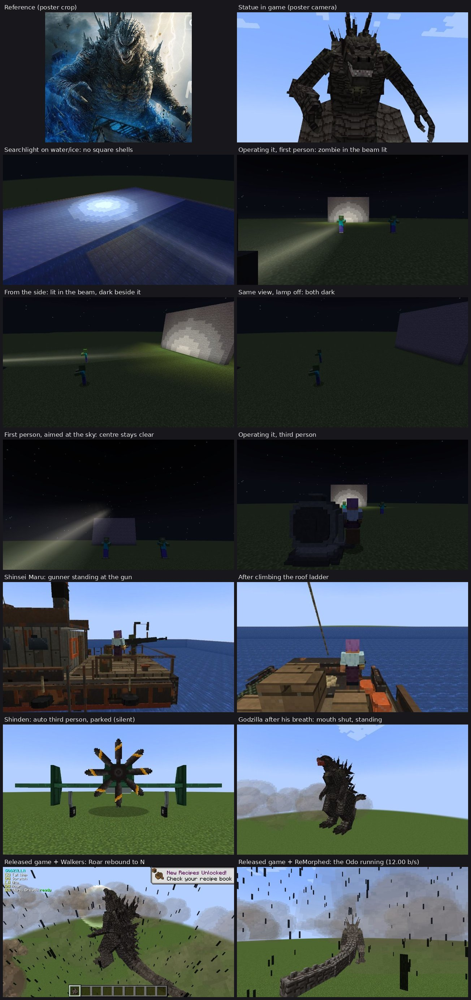

# Godzilla Minus One — Forge 1.20.1

A Minecraft Java Edition (Forge 1.20.1, GeckoLib 4) port of the Bedrock add-on
**"Godzilla Minus One" V3 by GojiDraw**. Godzilla is the add-on's own model, textures and animations, exactly
(scaled up evenly to stand 10 blocks taller), and so are the Shinden, naval mine, sounds and effects. The atomic
blast follows the **Ginza blast in the film**, from the flash to the mushroom cloud breaking up, built from **Alex's
Caves'** mushroom cloud textures. The mod also adds the **Odo Island Monster** (Godzilla's smaller, dinosaur-like
form from the start of the film): Monster122's
**Godzillasaurus** from the "G-1" Bedrock add-on, with its own model and animations. There are also the **Shinsei
Maru**, the film's little minesweeper with its stern machine gun and a hold of naval mines, a **searchlight**, a
**nuclear bomb**, a **remote detonator** for the naval mines, and posed **Godzilla statues** for screenshots and
thumbnails. With **Walkers** or **ReMorphed** installed, you can **play as Godzilla**.


*GojiDraw's Godzilla from the front, side and three-quarters, and charged (his plates up and glowing icy cyan).
Offline renders on a one-block grid (darker lines every 10 blocks); the small blue box is a player, 1.8 blocks
tall.*


*The add-on draws him 6.1x (35.4 blocks tall, 59.3 long); the mod 7.83x, evenly (45.5 tall, 76.1 long).*


*The Odo Island Monster (Monster122's Godzillasaurus, his hide turned grey and brown): front, side and
three-quarters, walking, roaring, and burnt to a crisp by a nuclear bomb. Same grid and player as above.*


*The Shinsei Maru, run down and weather-beaten: rust weeping down her hull, paint flaking, a rust-red waterline,
tyres for fenders, the wheel up on the wheelhouse roof, nets, floats and cages on the foredeck, boarding ladders
port and starboard, a rack of recovered naval mines astern and the Type 93 machine gun on the stern platform.
Offline renders.*




*The thumbnail statues as you see them standing in front of each (they turn to face you): charging roar (its tail
plates aglow), tail whip, roar to the sky, the 70th anniversary poster (mouth and every plate aglow) and the tail
hook. Offline renders (tools/preview_poses.py) on a one-block grid with a player.*


*The atomic blast at the default settings, seen from 440 blocks away: the flash whiting out the view (0.15 s); the
fireball, with the ring of mist racing out through the air (1 s) and the dust wave rolling out over the ground (3 s);
the column rising under it as it spreads into the cap, glowing only low down (8 and 15 s); the full-grown cloud,
its fire out (30 and 60 s); breaking up, the cap broadening and thinning from its edges (120 and 150 s); the last
scattered smoke and ground haze (175 s).*


*The same at 0.15, 2, 8, 20, 60, 135 and 172 s, from the side at eye level 760 blocks off, a player's eye 440 off,
three-quarters from 260 up, from below near ground zero and from 620 up. Both are offline renders of the same cloud
(tools/preview_blast.py, not game captures), over 20-block squares; the red post is Godzilla's height (45 blocks),
the blue one a player.*

## Requirements

- Minecraft 1.20.1 with Forge 47.x
- [GeckoLib](https://www.curseforge.com/minecraft/mc-mods/geckolib) 4.x for 1.20.1 (4.8.4 tested against)
- Optional: [AttributeFix](https://www.curseforge.com/minecraft/mc-mods/attributefix), only if you raise
  Godzilla's max health above 1024 in the config
- Optional: [Walkers](https://www.curseforge.com/minecraft/mc-mods/woodwalkers) (5.8.x, with its library
  CraftedCore) and, if you like, [ReMorphed](https://www.curseforge.com/minecraft/mc-mods/remorphed) (4.2.x), to
  play as Godzilla (see **Playing as Godzilla**). Neither is needed otherwise.

## What's in it

| Add-on content | In this mod |
| --- | --- |
| `goji:gojira` (+ dead / spawn stages) | **Godzilla** (`godzillaminusone:godzilla`), one entity with emerge → roar → active → collapse → dead → regenerate phases |
| `goji:kyushu_j7w1` | **Kyushu J7W1 Shinden**, a fighter you can fly |
| `goji:torrid` | **Torrid**, the Shinden's cannons: hold right-click while flying it |
| `goji:mine_spawn` / `goji:mine` | **Naval Mine**, craftable (4 netherite ingots, 4 netherite blocks, TNT in the middle), and a **Remote Detonator** for it |
| `goji:nuclear_hole` | The crater and blast wave left by the atomic breath |
| Nuclear explosion particles | The atomic blast's flash, fireball, dust wave and mushroom cloud (`client/render/NuclearCloud.java`, after the film's Ginza blast), its sparks and the black rain |
| Particles, camera shakes, custom boss bar | Recreated in Java (see `client/`); the fade to black is a blur instead |
| *(from Monster122's G-1 add-on)* | **Odo Island Monster** (`godzillaminusone:odo_island_monster`), with its spawn egg |
| *(new, the mod's own model)* | **King Ghidorah** (`godzillaminusone:king_ghidorah`), as tall as Godzilla Minus Zero, with his spawn egg |
| *(new, from the film)* | **Shinsei Maru**, the minesweeper: a boat with a stern machine gun and a hold of naval mines |
| *(new)* | **Searchlight**, a mountable WWII searchlight |
| *(new)* | **Nuclear Bomb**, called in from the sky |
| *(new)* | **Godzilla statues** in five poses, `/summon` only |

### Godzilla

- GojiDraw's model, 45.5 blocks tall, 21.7 wide and 76 long (tail and dorsal plates included). Spawns from
  his egg by rising out of the ground and roaring, then becomes active (with the add-on's boss bar).
- **His roar carries for 3000 blocks**: faint that far off, louder at 2000, louder again at 1000, and so on as
  you get closer (loud, but not painful in headphones). **From 200 blocks away you hear a distant roar** instead
  (two recordings, taking turns from one roar to the next); closer in, the roar itself. Each listener gets exactly
  one of the two, picked by their own distance, so they never play over each other.
- **Radiation aura**: anything within 16 blocks gets **Radiation**, the mod's own effect (a radiation trefoil for its
  icon; it hurts every 2 seconds, faster at higher levels), instead of Wither, and there's no on-screen warning any
  more. A whole **hazmat suit** keeps it off (see **Hazmat suit** below). An atomic blast's fallout gives Radiation too.
- Every footfall shakes the camera, hurts everything near him and **crushes a footprint** of rubble into the
  ground. **Walking, he destroys everything in his path at Y 60 or above** (buildings, trees, the hillside: anything
  but liquids and bedrock) **and nothing below Y 60** (`walkBreaksFromY`; his footprints too; needs `mobGriefing`), and
  **buildings fall over** as he wades through them
  or swipes at them: the walls high up beside him topple as falling blocks, thrown the way he's going (or away
  from his swipe), and come crashing down; what's below them breaks apart.
- **He knocks down tall buildings**: when there's nothing in sight for him to kill and he sees anything built
  standing **half his height (23 blocks: he really stands ~45 tall) or more** above the ground (within 64 blocks),
  he goes over and swipes at it, ten layers at a time (the top of it toppling away from him), until it's down to
  **a quarter of his height (11 blocks)**, then leaves it alone, and **leaves buildings alone for 20 seconds**
  (`demolitionIntervalSeconds`) before he picks the next. Trees and hills don't count. A mob turning up sends him
  after it instead. (This is separate from what he breaks just by walking into it or treading on it.)
- **He roars every 2 minutes** (stopping where he is to do it); set how often in the config screen.
- Up close he attacks in a combo: a **claw swipe with each hand**, then a **heavy spin** of his whole body with
  the tail sweeping round him and **snapping like a whip**. **His claws tear through what's built** where they rake
  (7 blocks round them, through walls too), and **his tail knocks away what's built round him**, low down (up to 10
  blocks above his feet, out to 30 blocks as it sweeps round and 38 as it snaps), the blocks flung outwards (needs
  `breaksBlocks` and `mobGriefing`). **What his blows break** (Minus One's and Minus Zero's alike): everything built,
  and the rest of Minecraft's **Building Blocks** too, though the world makes them: **terracotta** of every colour
  (glazed too), **mud** (mud, packed mud, mud bricks, muddy mangrove roots), **andesite, granite, diorite, stone, tuff,
  deepslate**, **logs and wood, stripped or not**, sandstone, basalt, blackstone and end stone. The ground proper
  (dirt, grass, sand, gravel, clay, ores, ice) is left. He bites at things above him, stomps on things
  under his feet, and swings the tail round at anything behind him. His **bite** is a real bite now (head rearing
  back, jaws gaping, then a lunge and a snap), with its own sound as the jaws close.
- For the first **2 to 3 minutes after he appears** he can't use his atomic breath yet.
- **He only uses his atomic breath on a target 75 blocks away or more** (`minTargetDistance`); anything closer he
  walks up to and fights in melee. This is checked when he decides to start a charge: a charge under way is never
  called off. (Wandering about, with no target, he doesn't breathe at all.)
- With a target that far off he **charges his atomic breath**: the dorsal plates light up blue one by one from the tail to
  the neck as they punch up, mobs freeze in fear, he breathes in for 4 seconds (the in-breath sound lasts
  exactly as long), the inside of his mouth glowing blue, faintly at first and ever brighter until it blazes just as
  he fires, then rears his head up above his chest and fires, **his head turned to whatever he's firing at**: left
  or right, up at planes, down at things close by (his body following round more slowly). The
  plates **slam back down the instant the beam appears**. The beam pours out between his open jaws, which blaze blue
  while it lasts. **Two seconds after the beam lands**, a **nuclear blast** goes off there: it kills everything
  around it and blasts out a **large crater** (about 96 blocks across and 20 deep) at once, and you see it unfold as in the film's Ginza scene (see
  **The atomic blast** below). Everyone nearby sees a blur, then black rain falls around ground zero (just
  particles: the weather isn't changed).
- **Out to 100 blocks the world is left in ruins**: whatever is still standing (trees, buildings, villages) is
  burnt and broken: leaves burnt away and trunks charred black, crops and grass dead, windows blown in, wooden walls
  and roofs holed and charred, stonework cracked and holed, fires here and there (less damage further out). The
  radius is `ruinRadius` in the config.
- The blast **levels the land for 60 blocks around**: everything above **Y 65** (trees, grass, buildings,
  hills) is obliterated, sweeping outwards from ground zero, and **nothing drops**. Seas and rivers stay. Parts of
  the area that aren't loaded yet are flattened when they load. Radius and height are in the config.
- As the beam dies out he **roars, the whole roar** (5.5 seconds), then he's back on his feet: jaw shut, back to his
  normal stance, walking and fighting again. (He used to freeze there, mouth open: the roar he'd have let out on
  his own during the charge followed straight after. It no longer does.)
- He then needs **3 minutes to recharge** before the next breath (change it in the config screen).
- The breath **burns his own mouth**: the flesh round it is left raw, blistered and glowing, smoking and
  spitting embers, then tears and knits back together over 40 seconds.
- **A plane in the air always comes first**: if someone is flying a Shinden, he goes after it.
- He regenerates while calm and likes to wander into water. In shallow water he walks along the bottom; in deep
  water he **swims at the surface** with his dorsal plates out of the water, runs down boats and bites at them
  (a new swimming bite, he doesn't stand up). Every 10 seconds his **head comes up out of the water** and
  glares around for 4 seconds, then sinks back under.
- **In the water, the Shinsei Maru is his main focus**: while he's swimming (or wading) and she's afloat within
  his reach, he forgets everything else and goes after her, for her helmsman first, then her gunner, and keeps
  after her even with nobody aboard. One bite or swipe wrecks her.
- **Only naval mines hurt him** (as in the add-on), each taking about 10% of his health and stunning him.
  At zero health he collapses (5 seconds), lies defeated for **15 seconds**, then regenerates and rises again. **Set
  how long he lies there in game**: Mods, Godzilla Minus One, Config, **Lies Downed** (0 to 10 minutes, in steps of 5
  seconds). It's `downedSeconds` (0 to 3600, default 15) in the `godzilla` section of
  `config/godzillaminusone-common.toml`: counted from the end of his collapse, which, like his getting up, plays as
  always. The server keeps the time (in single player, the world on your computer), so on a server only its file counts.
- **One hit brings him down while he breathes in.** During the 4 seconds he takes his deep breath in, just before the
  beam, a **Shinden takes all his health in one hit**: flown into him (into his face, or blown up by his radiation as it
  closes in anywhere near him) or **one Torrid burst** into him (his head or body, nothing solid in the way). He
  collapses and lies downed as when the mines bring him down, and the beam never comes. (`shindenInhaleKnockout`, on.)
- **The one exception: his burnt face.** While his mouth is still raw from his atomic breath (the 40 seconds it
  takes to heal), a Shinden flown **straight into his face** at full speed takes **all his health**: he collapses as
  when the mines bring him down. Only his face counts (not his chest, tail or legs), and not once it has healed.

### Godzilla Minus Zero

- **What Godzilla Minus One becomes when he's brought down.** At zero health Minus One collapses (5 s) and lies there
  for the downed time (**Lies Downed** in the config screen, `downedSeconds`), and then **Godzilla Minus Zero rises in
  his place**: exactly one, where Minus One lay, facing the way he faced, at full health (Minus One's maximum health),
  getting up with Godzilla's rise and roar, and going after whoever brought Minus One down if they're still about.
  Minus One is gone the moment Minus Zero is there. Once per Minus One: every way of bringing him down counts (naval
  mines, a Shinden in his burnt face, the one hit during his in-breath), more blows while he's down change nothing,
  and his pending evolution is saved with him (the world saving, or his chunk unloading and loading, neither loses
  it nor makes two). It all happens on the server; everyone sees the one Minus Zero. `/kill` and the void just remove
  Minus One, no evolution. Bringing Minus One down still unlocks his shape with ReMorphed, once.
- **Twice Minus One's standing height**: Minus One stands 45.37 blocks from the ground to his highest point (his
  standing pose, plates included); Minus Zero 90.74. His whole body is scaled (not just stretched upwards), his
  hitbox is twice Minus One's (20 wide, 80 tall), and every point on his body and every reach that comes from it is
  twice as far out: his mouth (where the atomic breath's beam starts), his claws and their reach, his tail sweep (60
  and 76 blocks), his feet and footprints, his stomp, his face (where a Shinden strikes), the depth of water he swims
  in, his bite's reach.
- **Everything else is Minus One's**, unchanged: health, damage, speed, cooldowns, his moves (the claw swipes, the
  spin and tail whip, bite, stomp, the swimming bite), the atomic breath's charge (plates lighting up, the
  in-breath), his roars and sounds, radiation aura, regeneration while calm, swimming,
  breaking and demolishing buildings (the same 23-block rule), the Shinsei Maru and Shinden rules, and the config
  (his breath's second blast, his bigger blasts and his tail strike, below, are his own).
- **Brought down, Minus Zero falls for good**: he collapses, lies there 3 seconds and dies (no Godzilla after him, no
  getting up again). That ends the encounter.
- **His spawn egg** ("Spawn Godzilla Minus Zero", creative tab, no recipe): a vanilla-style egg, charcoal with
  grey-green spots. He rises out of the ground and roars, as Godzilla does from his egg. No natural spawning.
- `evolvesIntoMinusZero` (`godzilla` section, on): turn it off for Minus One to regenerate (or die, with
  `regenerates = false`) as before.
- **His look**: Minus One evolved, this mod's own design (`tools/make_minus_zero.py`): Minus One's model with a
  **second, staggered row of plates** along his lower back and tail, smaller than the first and tilted out (the
  **side rows**: they rise and light for his second blast, his middle row for his first), **overlapping armour bands**
  round his upper arms and forearms and **layered caps** on his shoulders, a **row of spines along either side of his
  tail**, **every plate drawn out into a short, broad point** (a third of the plate's height again; the plate at the
  end of his tail into the longest on his tail), **thicker thighs and shins**, and a
  **darker, heavier skin** (his scorched skin when he's down too).
- **His beam stops at whatever is in its way** (Minus One's and Minus Zero's): a building, a hillside, any block. It's
  drawn only as far as that block, its impact blazing there (a blue-white flash, blue fire spraying off it, debris and
  smoke), its blast goes off there, and nothing beyond it is hit.
- **His atomic breath has a second blast**: the charge is Minus One's, but only his **middle row of dorsal plates**
  lights up and punches up for it (the side rows stay down and dark); his beam fires and, 2 seconds later, the
  first nuclear explosion goes up where it lands. His beam stays on (his first breath lasts longer than Minus One's)
  while the blue glow on his middle row **dims out over 2 seconds**; then **the side rows light up** in a sharper,
  brighter blue and **punch up**, one after another from the end of his tail forward, over the next 2 seconds (the
  middle row stays down); then they **punch back down** and he **fires a second blast**: the
  beam grows about a third wider and twice as bright, hits a wider band round it, twice as often, and 2 seconds after
  it lands **a second nuclear explosion** goes up. **His own sounds**: as his plates finish lighting up again, he
  **charges again** (finishing as he fires), and his **second beam fires** with its own sound. Each explosion is **twice the size of Minus One's**: twice every
  radius (kill, fallout, crater, scorch, ruins and flattening), and **a mushroom cloud twice as big** (twice as tall
  and wide). After the beam his **mouth, throat and chest** are left burnt raw (Minus One's: his mouth), healing as
  Minus One's burns do. Minus One's breath is unchanged.
- **His tail strike**: every other spin of his is his tail strike instead. The plate at the very end of his tail
  **punches up and blazes blue-white**, with its own sound, its glow spilling out round it in a broad pulsing halo, for a
  second, then he spins and whips his tail round as in his spin (with the **whoosh of it swinging round**), **twice as hard**:
  what's alive takes **double damage** and is flung away, and **anything else it hits is destroyed**: boats wrecked, a
  manned Shinden blown up, armor stands and any other thing gone, and **every block in its sweep**, from the ground he
  stands on up to as high as his tail goes (rock, earth and trees as well as what's built; not liquids or bedrock;
  with `breaksBlocks` and mobGriefing on, as all his block breaking).
- Every bone is Minus One's, so all of Minus One's animations play on him (his second blast and tail strike are
  Minus One's charge and spin with his own parts added: `tools/make_minus_zero_animations.py`). None of the new parts
  reaches above Minus One's highest point, so at exactly twice the scale he stands exactly twice as tall.

### King Ghidorah

- **An enormous, ancient three-headed golden dragon**, the mod's own model (`tools/make_ghidorah.py`): **as tall as
  Godzilla Minus Zero** (his heads 90.74 blocks up as he stands; his raised wings reach higher) with Minus Zero's
  hitbox (20 x 80). A broad armoured chest and massive shoulders, three long segmented necks, a narrower waist,
  powerful hindquarters on two muscular legs with three-taloned feet, a cluster of tall spear spikes on his upper
  back, and two long tails, each ending in a spiked mace. His wings are his forelimbs (no arms): huge bat wings with
  armoured leading edges spurred with spikes, a hooked claw at each wrist, and dark brown-burgundy membranes, veined
  and scalloped: **each wing one sheet from its fingertips to his flank**, joined to his body (it never comes apart
  into separate pieces, however the wing moves). His hide is weathered gold, tarnished bronze, ochre and olive-brown,
  scaled and plated all over: rows of scales down each side of his necks and two rows of spikes down their backs,
  scutes across his breast and belly, ridges of armour along his flanks, spikes out to either side of his tails,
  spurs at his knees and scales down his thighs; small amber eyes sunk under heavy brows, and every head with its own
  jaw, teeth, horns, a crown of spikes, knobs down its snout, cheek spikes and a jagged beard.
- **He stands crouched low on bent legs, leaning on his wings like front legs: the claws at his wrists planted on the
  ground** and the wings half spread above them, **never folded** (only while he digs himself out of the ground are
  they tucked), heads looking every which way, as in the first reference picture. He walks the same way, on all
  fours: each wing claw lifts, swings forward and is planted again in step with the hind foot on the other side.
  **His hind feet step on the ground, not over it**: each comes down flat and stays put where it landed while he
  walks on over it (his legs are worked out frame by frame for where each foot must be), then lifts and swings
  forward. **Every footfall is like Godzilla's**: the ground shakes, everything close by is hurt (`stepDamage`,
  `stepRadius`; not Minus Zero), and **a footprint is crushed into the ground**, a hole of rubble the shape of his
  foot (`footprints`; from Y 60 up, `walkBreaksFromY`, as Godzilla's; needs `breaksBlocks` and `mobGriefing`). **Each head has a mind of its own**: it looks about at its own pace, out of step with the
  others, turning towards what he's looking at but never quite all together.
- **Minus Zero's health and durability, and his ways**: Minus Zero's `maxHealth` and `attackDamage`; only naval
  mines hurt him (a tenth of his health each, `mineDamagePercent`; `onlyHurtByNavalMines`), a nuclear blast does
  nothing to him, and while he has nothing to fight he heals (`calmRegenPercent`). He hunts as Minus Zero does (every
  creature with `targetsAllMobs`, else players, Shinden fighters, iron golems and hostile mobs) and **Godzilla too**,
  roars as often (`roarIntervalSeconds`), and tears through what's built as he walks (only at Y 60 and up:
  `walkBreaksFromY`). Brought down, he collapses and is gone.
- **His attacks**:
  - **Bite**, with whichever of his three heads is nearest, lunging down from 50 blocks up while the other two rear
    back and snarl; it bites through what's built where its jaws close.
  - **Stomp**: his right foot raised high and brought down on whatever is under him, crushing a footprint (from Y 60
    up, as his walk).
  - **Tail whip**: his body twists and both tails swing round behind him, striking and flinging whatever is in their
    sweep and sweeping away what's built.
  - **Gravity beams**, from 40 to 160 blocks: he braces, his wings half open, and his three heads fire in turn:
    **beams of golden lightning**, each jagged like a bolt of lightning (its zigzag struck anew every other tick),
    blazing and white-hot at the core, glowing as Godzilla's breath does (drawn the same way, so shader packs light
    them up as they do his) and crackling with forking bolts, **lighting up the ground and the air round them** with
    warm yellow light as they sweep (light blocks in the air along them, gone as they stop), that bore straight
    through whatever is in their way, **leave a trail of explosions where they strike as they sweep** (his gravity
    beams; not his lift), and **vaporize every block 12 blocks round where they
    strike** (and along their last stretch of path), and whatever is caught there (all but liquids and bedrock;
    `breaksBlocks` and mobGriefing allowing).
  - **Lift**: his beams seize their target, **haul it high into the air** (34 blocks), hold it, and let it fall.
  - **Grab**: he takes off, flies at his target, **seizes it in his talons** (a player, Godzilla, anything), carries
    it high (48 blocks), and **dives, slamming it into the ground**. A player can't wriggle free.
  - **A Shinden up in the air: he flies after it** (faster than it can fly, for up to 30 s), his body below it and
    his heads up level with it, until one of his heads catches it in its jaws and it blows up there (its pilot bails
    out; the blast hurts him as a naval mine would). Then he comes down. **If Godzilla Minus Zero is near, he leaves
    the plane and comes down for him.** A Shinden on the ground he fights as anything else.
- **Coming down out of the sky** (after his grab, at the end of his retreat), **he drives a big ditch into the
  ground**: 5 blocks deep and flat-bottomed 15 blocks round where he lands, its sides sloping up to the ground about 26
  blocks out, its floor rubble and the earth thrown out of it heaped round its rim; he sinks into it, and walks up out of
  it. Everything standing in it goes (24 blocks up); lakes and the sea keep their bed. It's dug, so it goes below Y 60
  too (as the atomic breath's crater does); it needs `breaksBlocks` and `mobGriefing`.
- **Retreat**: with his health low (`retreatHealthPercent`, 20%) he takes to the air and flies away from whatever
  he's fighting, lands far off and lets it go (healing while he's left alone). Switch it off on the in-game config
  screen ("King Ghidorah Retreats") or with `retreats` in `godzillaminusone-common.toml`.
- **His entrance**: spawned (his egg, `/summon`), **he rises out of the ground**, about 15 seconds: the ground cracks,
  cracks spreading out from where he'll rise with dust spurting from them, a deep rumble and the sound of breaking
  earth, bursts of dirt and rock; one head rises through the broken ground and looks deliberately about; the other two
  follow, each in its own time, uncoiling; his body hauls itself out after them in three heavy lurches, wings tucked,
  amid dense dust and flying debris; a pause, and his wings spread slowly to their full span, dust rushing out along
  the ground and loose earth falling from him; and all three heads throw themselves up and roar. **As he starts to
  haul himself up and out (8 s in), the ground gives way round him: a huge hole where he comes out of it**, 13
  blocks deep and flat-bottomed 24 blocks round him, sloping up to the ground about 50 blocks out (gently enough for
  him to walk out of), its floor rubble and its earth heaped round its rim, caving in over a second or so from the
  middle out, and he sinks down into it as he climbs (like his landing's ditch: `breaksBlocks` and `mobGriefing`;
  below Y 60 too). Until then the ground only seems to break (the
  debris is made of the ground's own blocks), and his body rises from below the surface as part of his animation.
  Nothing hurts him while he rises, and nothing but the ground giving way under him moves him. It happens once per spawn, not when he's loaded again. **Three seconds after it ends his own weather
  comes** over the dimension: **no rain, the sky overcast** (dark grey, heavy grey clouds, the daylight dimmed about
  as much as in a thunderstorm, coming on and clearing over 5 seconds), and **lightning twice as often as in a
  thunderstorm** (the game's own lightning: flash, thunder, fires). Every player in the dimension gets it; it's saved
  with the world, so it carries on after a reload; not in the Nether or the End. The delay and its length are in
  `godzillaminusone-common.toml` (`entranceStormDelayTicks`, 60; `entranceStormDurationTicks`, 6000, 0 for none);
  how hard the ground shakes your view is on the config screen ("Ghidorah's Entrance Shake", 0 for none).
- Everything he does runs on the server's clock: a player who comes in halfway through his entrance (or anything
  else) sees it from where it is, not from its beginning.
- **His sounds** are his own sound pack's, each named for when it plays:

  | Sound event | File | When it plays |
  |---|---|---|
  | `king_ghidorah.entrance_roar` | `king_ghidorah_entrance_roar.ogg` | His entrance: all three heads roar as he finishes rising (12.5 s in) |
  | `king_ghidorah.wing_span_roar` | `king_ghidorah_wing_span_roar.ogg` | His roar, wings spread wide (on spotting a target, and every `roarIntervalSeconds`) |
  | `king_ghidorah.idle` | `king_ghidorah_idle.ogg` | Now and then while he stands or walks (a growl; silent while he rises) |
  | `king_ghidorah.hurt` | `king_ghidorah_hurt.ogg` | When something hurts him (a naval mine) |
  | `king_ghidorah.death` | `king_ghidorah_death.ogg` | When he's brought down |
  | `king_ghidorah.bite` | `king_ghidorah_bite.ogg` | Each bite, as the head's jaws snap shut; and as he seizes what he grabs in his talons |
  | `king_ghidorah.gravity_beam` | `king_ghidorah_gravity_beam.ogg` | Once as his beams fire (his gravity beams and his lift): they blaze for as long as it roars, about 5.6 s, and stop as it fades |
  | `king_ghidorah.flying` | `king_ghidorah_flying.ogg` | While he's in the air (his grab, his retreat): from takeoff, again every 8.2 s, until he lands |
  | `king_ghidorah.footstep_1` / `_2` / `_3` | `king_ghidorah_footstep_1.ogg` ... `_3.ogg` | **Every step, in turn: 1, 2, 3, 1, ...** (never the same twice running): each hind foot coming down as he walks (his walk animation and its footsteps go by the same clock, so they land with his feet, and you hear him walking even when he's out of view), his heaves out of the ground in his entrance, his landing |

  His **stomp** sounds as **Godzilla's stomp** does (`godzilla.stomp`, at Minus Zero's size). The entrance's rumble,
  cracking earth and wing rush (`king_ghidorah.rumble`, `.earth_crack`, `.wing_spread`, also on takeoff) aren't in the
  pack and are synthesized by `tools/make_sounds.py`; his tail whip uses Minus Zero's tail swing.
- **King Ghidorah and Godzilla Minus Zero are rivals.** Within 160 blocks of each other, **each makes the other his
  target before anything else**, mobs and players alike. **Minus Zero, seeing King Ghidorah, roars** and the moment
  the roar is over **charges his atomic breath** at him, however near or far, whatever his breath's cooldown. Between
  them, **every attack takes 1/20 of the other's health** (neither is hurt by anything else but naval mines), and the
  heavy ones **four times that (1/5)**: Minus Zero's **atomic breath** (each of his two beams, with its blast), and King
  Ghidorah's **gravity beams**, his **lift** and his **flying slam**. An attack lands once, however long it burns on
  him: a beam sweeping over him for seconds is one blow. (A kaiju with its AI off, standing for a picture, goes for
  nobody.)
  - **Godzilla Minus One and King Ghidorah hurt each other the same way** (1/20 of his health a blow, the heavy ones
    four times that). **Brought down by King Ghidorah, either Godzilla (Minus One or Minus Zero) lies there a minute
    and gets back up, once**; brought down by him a second time, **he's dead**. (Brought down by anything else, he does
    as before: Minus One evolves or regenerates, Minus Zero falls for good.)
  - **A Godzilla breathes at King Ghidorah the once**: when they first face off (Minus Zero's roar, then his breath).
    Meeting him again after that, he doesn't fire his breath at him: **they just fight**. (Kept with him when the
    world is saved.)
  - **Minus Zero never fires his breath at a Shinden**: he follows it instead, and a charge already under way stops
    when his target turns out to be one. King Ghidorah coming near, Minus Zero goes for him instead.
  - **King Ghidorah retreating, Minus Zero goes after him**: as long as he's flying off (480 blocks), Minus Zero
    keeps him as his target, nothing else, and follows him.
  - **Minus Zero charging his breath, King Ghidorah waits**: he holds where he is, facing him, until the beam's fired;
    then he's at him again.
  - **If King Ghidorah seizes Minus Zero in his talons, Minus Zero's breath is cancelled** (charging or firing: it's
    over, and comes back after its cooldown). Minus Zero only starts a breath with his feet on the ground (not carried,
    not in the air), so **his beam always comes from his mouth**, where he stands.
- His spawn egg is a vanilla-style egg in weathered gold with burgundy spots. He doesn't despawn.

**His model** (`assets/godzillaminusone/geo/entity/king_ghidorah.geo.json`, GeckoLib 4, Forge 1.20.1): 104 bones in a
hierarchy, named for what they move: `root` > `pelvis` > `torso` > `chest` > `back_spikes`; `neck_c_1`..`neck_c_8` >
`head_c` > `jaw_c` and `mouth_c` (and the same for `_r` and `_l`, his right and left heads); `wing_shoulder_r` >
`wing_upper_r` (> `wing_web4_r`) > `wing_fore_r` (> `wing_web5_r`) > `wing_hand_r` > `wing_claw_r` and
`wing_finger1_r`..`3_r` (each > `wing_web1_r`..`3_r`, the membranes, which fold as their bones' y scale shrinks); `leg_thigh_r` > `leg_shin_r` >
`leg_foot_r` > `leg_toes_r`; `tail_r_1`..`tail_r_10` > `tail_r_tip`; and the `_l` side, mirrored. Each membrane
hangs on two bones of its own (`wing_webN_r` > `wing_webN_skin_r`, pivoting at the wrist, or the shoulder for the
inner one), turned and scaled in every frame of every animation so that it stays pinned at its three anchors (the
wrist and two finger tips; the wrist, the last finger's tip and the elbow; the elbow, the last finger's tip and his
flank; the shoulder, the elbow and his flank): the wings can spread, beat, raise or tuck and the membranes go with
them, and since every edge two panels share runs between two of their anchors, they always meet along it: each wing
is one sheet, joined to his flank. `mouth_c`, `_r`
and `_l` are empty bones at the tips of his snouts: where his beams come from (the renderer draws them from where the
animation has put those bones). **His animations** (`animation.king_ghidorah.*`): `idle` (breathing, each head looking
about on its own, his tails swaying slowly), `walk` (heavy alternating strides, his hips dropping and rolling with
each footfall, the planted wings stepping like front legs), `roar`, `bite_c` / `bite_r` / `bite_l` (one head lunges, the others stay busy) and
`gravity_beam` (necks brace, heads aim, staggered anticipation and recoil, then 5.6 s of fire), `gravity_lift`, `stomp`, `tail_whip`,
`fly` and `fly_carry` (after the third reference picture: his body pitched into the air, wings beating hard, the beat
rippling out along each wing; legs drawn up, or reaching down with talons clenched round what he carries), `death`,
and `entrance` (the root bone carries his body up from below the surface). His beams' mouths are `mouth_c`/`_r`/`_l`.

**His texture** (`textures/entity/king_ghidorah.png`) is 512 x 512, at **2 texels per model unit on every face** -
the same density as Godzilla's and Minus Zero's skins (256-unit sheets at 512 px), so they read alike side by side,
and at his size (one model unit about 0.78 blocks) a texel is about 6 Minecraft pixels across: fine enough for each
small scale and the seams between plates, coarse enough to stay crisp pixel art at a distance. Every face has its own
texels (per-face UV), cubes of the same shape and kind share theirs and his left side's are his right side's,
mirrored, which is what lets the whole of him (760 cubes) fit one 512 px sheet. (His height is measured to his heads,
not his raised wing tips: his body stands as tall as Minus Zero's, his wings rise above it.)

### Kyushu J7W1 Shinden

- Right-click to climb in. **The view switches to third person**, pulled back 11 blocks so the whole plane (13
  blocks wingspan) is in frame, and back to first person when you get out (F5 turns the view round to the front
  and back while you fly).
  **W** accelerates, **S** brakes, the mouse steers: look up to climb, down to dive.
  The plane noses up as it climbs and down as it dives, stays level in level flight, and banks into turns.
- **Hold Left Control to look around** ("Shinden Free Look" in Options, Controls, Key Binds, Godzilla Minus One, to
  rebind): the plane flies on the way it was heading while you look; let go and your view swings smoothly back to the
  nose before the mouse steers again (no snap, no sudden turn). It only counts while you're flying a Shinden, so the
  same key still sprints everywhere else. The cannons fire along the nose.
- **Its engine is silent while it sits still on the ground**, even with you in it; you hear it once it's rolling or
  in the air.
- You stay in the cockpit however it pitches and banks. **Hold right-click to fire the plane's cannons**
  straight ahead: they keep firing for as long as you hold it, five rounds a second (a bang and a flash from
  each gun every round), whatever you're holding.
- Pilots have the add-on's "plot armour": Godzilla's blasts barely scratch them.
- Fly within 15 blocks of Godzilla and the plane detonates like a naval mine (the film's ending), and you bail
  out with Slow Falling as a parachute. **Burnt from his breath, he can be brought down by flying straight into his
  face** (see Godzilla, above).
- Crash into something at (near) full speed and it explodes on impact as big as **3 TNT** (a block-breaking
  explosion of power 12). You bail out and the explosion spares you. The blocks it blows up simply vanish:
  nothing drops, so the game doesn't slow down under a heap of items.
- Hit it like a boat: it rocks, and a few hits knock it back into its item (one hit in creative).
- **Multiplayer servers**: set `allow-flight=true` in `server.properties`, or flying players get kicked.

### Naval Mine

- Floats on water; can be leashed and towed.
- Hitting it by hand (or with a tool) doesn't hurt it: it rocks with a clank, and **four hits knock it loose**
  into its item so you can pick it back up (one hit in creative).
- Anything else that damages it sets it off: arrows, explosions, fire, Godzilla's footsteps, his radiation.
- **Found in chests**, as the same naval mine item the recipe makes (`godzillaminusone:naval_mine_spawn_egg`,
  "Spawn Naval Mine": use it to put a mine down), on top of the chests' usual loot (a global loot modifier: nothing
  is taken out):

  | Chest | Chance a chest has them | How many |
  | --- | --- | --- |
  | End city treasure | 25% | 1 to 3 |
  | Nether fortress | 15% | 1 to 3 |
  | Ancient city | 20% | 1 to 3 |

  1 six times in ten, 2 three times, 3 once (so a 3 is in 2.5% of end city chests, 1.5% of fortress chests and 2% of
  ancient city chests). The chances and the 6:3:1 weights are in `data/godzillaminusone/loot_modifiers/*.json` (a
  datapack can override them). It can still be crafted.
- **Remote Detonator** (a lightning rod on top as the antenna / iron ingot, redstone, iron ingot / iron ingot,
  stone button, iron ingot): point it at a naval mine up to 160 blocks away and right-click, and it goes off.
  Blast radius 30: stand well back.

### Odo Island Monster

- Godzilla's first form from Odo Island: Monster122's Godzillasaurus, **14 blocks tall** and 29 long, 600
  health. Crouched and leaning forward on huge bent legs, head held low in front on a thick curved neck, clawed
  hands hanging, a long tail behind, jagged plates rising high over his back, and a grey and brown scaly hide.
  His walk, roar, two bites (one with a swipe of his arm), stomp and burnt pose are the add-on's animations.
- Left alone he wanders and ignores you, but get within about 16 blocks and he **charges**: he runs you down,
  crashing through trees and fences, and **bites** or **stomps** you.
- **Buildings don't stop him.** Whatever is built in his way gives as he walks into it (brick, stone bricks, deepslate
  bricks and tiles, polished stone, concrete, iron..., anything short of obsidian; not the ground: rock and earth as
  the world made them, which he climbs). Going for someone with a building between them, if he makes no headway for 2
  seconds he tears it down towards them, and **up against a wall he bites into it: his bite bites through whatever is
  built where his jaws close.** (Before, polished stone and deepslate counted as rock to him, and harder blocks such as
  deepslate bricks didn't give at all, so he stood stuck behind them.)
- **Lit by a searchlight someone is working, he goes for the light**: he turns to stare straight into it and
  roars, then charges it, bites or stomps it to pieces (glass shattering, the iron frame clanging down), and
  comes straight for whoever was working it, in a frenzy. If the searchlight is up on or inside a building, he
  **tears through the building** to get at it (whatever it's made of), and brings down what it stands on, the light
  coming down with it. Blocked short of it (a wall, a building, a cliff), he **tears through whatever's in the way**
  from wherever he's stuck; if after 30 seconds nothing he can break gets him to it (up a natural cliff, say), he
  gives up on the light and goes for whoever was working it instead, so he never stands stuck. A player who comes
  close (12 blocks) while he's after the light draws him off it, onto them. A searchlight sweeping on its own
  doesn't bother him.
- **Spotted, he goes into a frenzy**: seen by a player (a player looking at him
  from up to 64 blocks away, or one he can see within 32), or hurt by one, he roars and comes for them: a third
  faster, biting and stomping 60% harder and twice as often, crashing through wooden doors too, and he
  doesn't let up for 90 seconds, even when they're out of sight.
- **His sounds** (each played once per event, from the server so everyone in range hears the right one): his roar
  (`odo.roar`), his shriek when a searchlight catches him (`odo.spotted`, in place of that roar), his arrival cry when
  he spawns (`odo.spawn`, heard ~64 blocks round, on its own: the old vanilla-timed growl straight after spawning is
  gone, and he doesn't roar over it for its first 4 seconds), his bite (`odo.bite`, as the jaws close), his cry when the nuclear
  bomb burns him (`odo.nuked`), and a distant roar (`odo.roar_far`) for anyone 100 blocks or more away when he roars
  or shrieks (out to 400 blocks).
- His spawn egg is an ordinary vanilla-style egg in his grey-brown and dark brown.
- **Nuke him** with a Nuclear Bomb and he doesn't die: he collapses, **burnt to a crisp**, the embers in his
  hide slowly going out. Nothing can hurt him while he lies there. **Three minutes later he rises again as
  Godzilla.** (Godzilla's own atomic breath just kills him.)

### Hazmat suit

- Four pieces: **Hazmat Hood**, **Hazmat Suit**, **Hazmat Trousers** and **Hazmat Boots** (in the mod's creative tab).
  Worn, it's a detailed blue chemical-protection suit after your reference: a blue hood and coverall with a zip down
  the front and seams, a black full-face mask with a big visor (reflections on it) and a respirator with its filter
  and valve at the chin, a black harness (shoulder straps, chest strap, belt and buckle) with a **yellow gas detector**
  and a **round pressure gauge** on it and an air hose, **two white air cylinders on the back** with **red diamond
  labels**, their valves and manifold, black rubber gloves to mid-forearm, and black rubber boots with yellow-green
  soles; worn and dirty, grimier low down. (A GeckoLib armour model: `tools/make_hazmat.py` builds it.)
- **Wear all four and radiation can't touch you**: Godzilla's aura and fallout don't give you Radiation, any you had
  washes off as soon as the suit is complete, and radiation damage (the heat of his charge too) doesn't hurt you.
- Armour about as good as leather (1, 3, 2, 1), as durable as iron. Recipes: hood: blue wool round a glass pane,
  charcoal under it (`BBB / BGB / _C_`); suit: `B_B / IKI / BBB` (blue wool, iron ingots, black wool); trousers:
  blue wool as leggings; boots: `K_K / S_S` (black wool, slime balls).

### Searchlight

- Crafted from iron ingots, glass, a redstone lamp and iron blocks (iron ingot, glass, iron ingot / iron
  ingot, redstone lamp, iron ingot / three iron blocks). Right-click the ground to set it up facing the way
  you look.
- The beam is a shaft of light: a soft glow as wide as the cone round a brighter core, fading with distance, with a
  pool of light picked out block by block where it lands. Each stretch of it is drawn facing you; seen down its
  length (as its operator does, or from behind them) the far part fades out, so it doesn't pile up into a glare in
  the middle of the view, and it fades where it passes right by the camera. **Those fades narrow the beam as well as
  dimming it, down to nothing**, and far off it fades into the fog with what it lights (the pool too: it no longer
  hangs in the fog on its own). That's for **shader packs** (Iris / Oculus), which draw it their own way and can
  ignore how see-through it is: then only its shape fades it, and that's what left a thin line in the middle of the
  screen and pools of light in the sky. With a shader pack on, it fades into the fog sooner. It's drawn after water and ice and never
  hides them: looking at it over the sea or through ice you don't see straight through to what's under the water.
  It ends at the surface of water, and lights up the surface there.
- **Mobs in the beam are lit up** where it reaches them, anywhere along it (not just where it lands): inside the cone,
  short of where it lands and with nothing solid between them and the lens, they're drawn as lit by a bright light
  (brightest near the lamp and on the beam's axis), never darker than the world has them. No glowing outline: they
  just stand in the light. Behind a wall, beside the beam or past where it lands they stay as dark as the night; move
  the beam off them or switch the lamp off and they go dark again within a few ticks. (Every player's game works this
  out from the searchlights it sees, so everyone sees the same.)
- **Left alone it sweeps round on its own**, like the hand of a clock, a full turn every 40 seconds, at the tilt it
  was left at, throwing a white beam.
- Right-click it to sit at it: the lamp turns and tilts with where you look (the beam keeps up with your view
  exactly, in first or third person). The beam reaches 160 blocks. Press
  **R** ("Vehicle Action" in Controls) to switch the lamp **off**, and again to switch it on; it stays as you left
  it. It widens as it goes and lights up **a wide pool** where it lands: a bright
  spot 10 to 25 blocks across (wider the further it reaches) on whatever it hits, lit by a ring of light
  sources up to 7 blocks out. Sneak to get off.
- An Odo Island Monster caught in the beam while you're working it comes for the light, smashes it and then
  comes for you (see above).
- Hit it like a boat to knock it back into its item.

### Shinsei Maru

- The film's small, run-down, weather-beaten minesweeper, **16.3 blocks long and 5.6 wide**: rust streaks, flaking
  paint, patched planks, tyres for fenders, nets and floats heaped on the foredeck. Crafted from a boat with five dark oak
  planks under it and an iron ingot on top (iron ingot in the top middle / planks, boat, planks / three planks).
  Use it on water to put her in, facing the way you look.
- **You can walk on all her decks** without falling through: the forecastle, the main deck and the side decks round
  the wheelhouse, the wheelhouse roof (the helm) and the stern platform. They're tiled with small solid sections that
  overlap, so there's deck under you whichever way she's heading and while she turns (checked at 16 headings by the
  game tests). Standing on her, you're carried along as she moves and turns; if she moves into you, you're pushed out
  (onto her deck if you're nearly up there).
- **Boarding ladders** on both sides, just aft of the wheelhouse, and one up the back of the wheelhouse to its roof
  and the wheel: walk or swim into one to climb it (sneak to hold on).
- **Two seats.** Right-click her **stern** (the gun platform) to take the **gunner's seat** at the **Type 93 13 mm
  machine gun**; right-click her **anywhere else** to take the **wheel**, up on the wheelhouse roof, and the mines.
  Only the gunner works the gun. **The crew stand**: the gunner on the stern platform behind the gun, the helmsman at
  the wheel. At the wheel: **W** ahead, **S** astern, **A/D** steer; she moves the way her bow points. Flat out she's
  **as fast as Godzilla swims** after something (8.4 blocks a second).
- **The gun points aft** and swings 135 degrees either way: the gunner aims it by looking, and it's **automatic**:
  hold right-click and it keeps firing (five rounds a second). A round **sets off a naval mine** it hits.
- **Naval mines**: sneak and right-click her to open her **hold** (9 slots, naval mines only), or right-click her
  with a naval mine in hand to load it. Up to three show in the rack on deck. The helmsman presses **R** ("Vehicle
  Action" in Controls) to **drop one over the stern**: it floats there, and goes off when Godzilla comes near
  (his radiation sets it off), like the film's mine dragged into his mouth.
- **She sits steady on the water**: no bobbing of her own, with or without Physics Mod. Physics Mod moves entities on
  its waves itself, as it draws them (see **Physics Mod** below): she's drawn like any other entity, so wherever its
  ocean is running it should carry her as it does a vanilla boat; her decks (what you stand on) stay level, as a
  vanilla boat's do. That last part hasn't been seen working: in CI's game its ocean never came up (see below).
- **Her motor**: under way you hear her old diesel chug, quietly, a little louder and higher as she picks up speed;
  it fades in as she gets going and out as she stops, one seamless loop per boat (a sound made for this mod by
  `tools/make_sounds.py`, not a recording).
- Hit her like a boat to knock her back into her item, mines and all (one hit in creative). Explosions and
  Godzilla smash her to matchwood, throwing the crew in the water.

### Nuclear Bomb

- Crafted from netherite ingots in the corners, TNT on the sides and a nether star in the middle.
- Use it while looking at a spot up to 256 blocks away: a bomb is dropped from high above it, marked by a red
  flare and a column of smoke. Everyone nearby gets a countdown and hears an **air-raid siren**, the only
  sound until it lands; it **falls for 20 seconds**, then goes off like Godzilla's atomic blast (same kill radius, radiation, crater and
  mushroom cloud; see the atomic blast options in the config). It goes off early if it hits something on the
  way down, such as a roof. Stand well back: the kill radius is 64 blocks by default.

### The atomic blast

Godzilla's atomic breath landing and the nuclear bomb make the same blast. Its damage, crater and flattening all
happen at the moment of impact. What you see unfolds like the Ginza blast in the film, anchored to ground zero,
the same size seen from anywhere (whatever Godzilla's size):

| Stage | Default timing (from the impact) | What you see |
| --- | --- | --- |
| Flash | 0 to 1.5 s | A white-hot core swelling in a moment into a pale yellow glare that whites out your view, then dying away; the sky lights up like lightning. |
| Fireball | 0 to 4 s | A ragged, blazing ball, white-hot, then yellow and orange, swelling to about 70 blocks and starting to rise. A ring of mist races out through the air and is gone within 3 seconds. |
| Dust wave | 0 to 8 s | A wall of dust rolling out over the ground (over hills and into valleys), fast, then slowing, out to about 230 blocks, leaving a haze behind it as it passes. |
| Column | from 1 s | As the glare fades, a thick, lumpy column of smoke rises under the fireball, its foot lost in the dust churned up round it. |
| Cap | up to 30 s | The fireball spreads into a broad, heavy cap, rolling over on itself: charcoal, grey and dirty brown, lighter billows on top, dark underneath, glowing orange only low down while it's hot. About 250 blocks tall and 290 across, its stem about 70 thick. |
| Cooling | glow out by 30 s | The fire inside dies out well before the smoke. Black rain falls from the cloud from about 6 seconds after the blast, for as long as it towers overhead. |
| Mature cloud | 30 to 90 s | It towers over ground zero, still slowly rising, spreading and rolling over. |
| Breaking up | 90 to 180 s | The cap broadens and softens, its outer billows thin away first, then its heart and the stem break up and drift, leaving scattered smoke and ground haze that fade last. (Longer than in the film, so it can be seen.) |

All of these are settings (see **Configuration**). The timings are a proposal for the film's sequence at a playable
pace, not measured from the film. You see the blast from up to 1024 blocks away and as far as your view reaches
(four times your render distance), through the fog.

### Godzilla statues (for thumbnails)

Godzilla frozen in poses from the film's posters. They never spawn on their own and have no spawn egg: make
them with `/summon`. A new statue turns to face you; it holds still (in mid-air too), does nothing and can't be
hurt. Hit it in creative mode, or `/kill` it, to remove it.

| Pose | Command |
| --- | --- |
| Roaring, one arm flung out, the glowing tail raised high round his side | `/summon godzillaminusone:godzilla_pose_charging_roar` |
| The tail swung round in front of him, its tip rising | `/summon godzillaminusone:godzilla_pose_tail_whip` |
| Roaring up at the sky, arms spread | `/summon godzillaminusone:godzilla_pose_sky_roar` |
| The 70th anniversary poster: braced in a low crouch, snarling down at you with his mouth lit blue, his left hand reaching forward with its claws turned up, every dorsal plate aglow and the tail rising behind him in a tall J | `/summon godzillaminusone:godzilla_pose_poster_snarl` |
| Turned three-quarters to your left, knees bent, growling, the near arm in front of his chest, the tail swept round in front of his legs and curling up in a broad open hook (unlit) | `/summon godzillaminusone:godzilla_pose_tail_hook` |
| Hunched snarl: almost square on, leaning forward, shoulders hunched up and forward and his head lowered between them, snout a little down, jaw slightly open; his right arm (on your left) bent with the claw forward at the bottom of his chest, his left (on your right) lower and further out with the claw open and angled down; left foot forward, knees bent (unlit) | `/summon godzillaminusone:godzilla_pose_hunched_snarl` |

**Screenshotting the hunched snarl** (`docs/hunched_snarl_preview.png` is the model as the mod draws it, from the
mod's files, and the in-game check below takes the same picture in the game): below his chest, almost square on,
looking up, tight on his head, shoulders, chest and both claws. In creative mode, on open flat ground:

1. `/summon godzillaminusone:godzilla_pose_hunched_snarl ~ ~ ~ {Rotation:[0f,0f]}` (he faces south)
2. Double-tap jump to fly, then, without moving from where you summoned him:
   `/tp @s ~-2.4 ~13.1 ~35.2 facing ~ ~29.8 ~` (your eyes 35 blocks in front of him, 15 up, a little to his right,
   looking at the middle of his chest)
3. Options: FOV **45**, and in Accessibility Settings **FOV Effects 0%** (flying widens the view otherwise); a 16:9
   window (1280×720, say); **F1** to hide the HUD, **F2** for the screenshot.

He holds perfectly still (no idle, no AI, no head turning), so you can take your time.

To face a statue a given way, give it a rotation, e.g. `/summon godzillaminusone:godzilla_pose_sky_roar ~ ~ ~ {Rotation:[180f,0f]}`.
The poster snarl and the tail hook already stand turned within themselves (30 and 55 degrees), so that facing you they show you
the poster's angle: get down low in front of them and look up, as the posters' cameras do. Their feet, the poster
statue's fingers and tail tip, and the tail hook's far arm and where its tail joins him aren't in the pictures,
so those are made up to match.

### Playing as Godzilla (Walkers / ReMorphed)

With [Walkers](https://www.curseforge.com/minecraft/mc-mods/woodwalkers) installed you can take Godzilla's shape:

- **Unlocking him**: with Walkers, hold its unlock key (**U**) while looking at him, or use
  `/walkers change2ndShape <player> godzillaminusone:godzilla` (then **G** switches to him and back); with
  ReMorphed, **bringing him down** counts as killing him (he never really dies) and unlocks his shape, or use
  `/remorphed addShape <player> godzillaminusone:godzilla`, then pick him from ReMorphed's menu.
- **Godzilla Minus Zero** too: bringing him down unlocks his shape in ReMorphed, or use
  `/remorphed addShape <player> godzillaminusone:godzilla_minus_zero` (Walkers:
  `/walkers change2ndShape <player> godzillaminusone:godzilla_minus_zero`). As him you're twice Minus One's size,
  every move reaches twice as far, his breath is **his breath with its second blast** (both blasts twice as big), and
  you have his **tail strike** (below).
- Walking as him, you **destroy everything in your way at Y 60 or above** and **nothing below it** (as he does:
  `walkBreaksFromY`), and **crush a footprint** where each foot comes down (`playerGodzillaBreaksBlocks`,
  `playerGodzillaFootprints`; also needs `breaksBlocks`, the `mobGriefing` gamerule and being allowed to build there). Charging the breath, his head follows
  where you look.
- As him you're always in **third person** (the camera pulled far enough back to show all of him; F5 still turns
  it round to face you), back to first person when you change back.
- **You never get stuck.** Press **M** ("Godzilla: Walk Through / Climb", rebindable) to switch between:
  - **Auto-Climb** (as you start out): you step straight up onto anything up to **20 blocks** high in your way (walls,
    roofs, ledges, cliffs), as a player steps up a slab (`playerGodzillaStepHeight`); and
  - **Walk Through**: you walk through anything, buildings and hills alike, still standing on the ground and falling as
    usual, never smothered inside a wall, and the camera doesn't get pulled in by the walls you're in.
  It's also on the config screen (**Played Godzilla: Auto-Climb / Walk Through**), and the list of moves in the corner
  shows which you're on. Your choice is kept (`playerGodzillaWalkThrough` in `config/godzillaminusone-client.toml`).
- As him, a small list of his moves and their keys sits in the **top left corner** of the screen:
  - **Z: Tail Whip**, a spin of his whole body, the tail sweeping round twice,
  - **H: Scratch**, a claw swipe (right, then left),
  - **J: Bite**: his bite (rear back, lunge, jaws snap shut), with its sound (a swimming bite in the water),
  - **K: Roar**: weakens and slows everything within 48 blocks for 10 seconds,
  - **B: Atomic Breath**: the full charge, beam and nuclear blast where it lands (flattening too, with
    `mobGriefing`), then a **3 minute** recharge, counted down beside it (change it in the config: it's his
    breath interval). You stand rooted from the start of the charge until the roar after the beam is over, then
    you're free to move again.
  - **X: Tail Strike** (as Godzilla Minus Zero): the plate at the tip of his tail punches up and blazes blue for a
    second, then the whip, **twice as hard** as his tail whip: whatever it hits is destroyed, every block in its sweep
    too.
  - **M: Walk Through / Climb** (above).
  His **tail whip and scratch tear down what's built** (and the rest of the Building Blocks), as the mob's do.
- **Every move is also a command**, for whoever is playing as him: **`/godzilla tailstrike`** (Minus Zero's tail
  strike), **`/godzilla breath`** (the atomic breath: as Minus Zero, his special breath with its second blast),
  `/godzilla tailwhip`, `/godzilla scratch`, `/godzilla bite`, `/godzilla roar`. The same move as the key, with the
  same waits and recharge (and a message if you can't make it: not Godzilla, not Minus Zero, still busy, recharging).
  These are the defaults. All six are ordinary key bindings: change them in **Options, Controls, Key Binds,
  Godzilla Minus One** ("Godzilla: Tail Whip", "Godzilla: Scratch", "Godzilla: Bite", "Godzilla: Roar",
  "Godzilla: Atomic Breath", "Godzilla Minus Zero: Tail Strike"). They're saved with the rest of your controls (`options.txt`), there's no other key
  setting anywhere, and the list on screen shows whatever they're bound to. They only count while you're playing as
  Godzilla (whether Walkers or ReMorphed made you him), so as yourself those keys are free for anything else; and
  Controls marks one red if it shares a key with one of the game's own. (Before this version these five, the
  Shinden's Free Look and the Odo's Run worked on their default keys but weren't listed in Controls, so they couldn't
  be changed: they're all there now.)
- Moves are seen by everyone near you (multiplayer). Whatever interrupts you (changing back, dying, respawning,
  changing dimension, logging out) frees you: you're never left rooted.
- Walkers' own keys are G, U, V and R (its shape's ability). **R is also this mod's "Vehicle Action"** (the Shinsei
  Maru's mines, the searchlight's lamp); rebind one of them if you use both.

### Playing as the Odo Island Monster (Walkers / ReMorphed)

Take his shape as you would Godzilla's (`godzillaminusone:odo_island_monster`):

- **He moves at 12 blocks a second** on level ground whenever he moves, **with no key to hold**
  (`playerOdoBlocksPerSecond`); sprinting adds nothing to it, and his shape runs. The speed-up is one modifier on your
  speed, made whatever it takes to cover 12 blocks a second, and it comes off when you change back, die or log out.
  (The Run key of the last version is gone.)
- **You're always in third person** as him, the camera far enough back for all of him to be in the picture (F5 still
  turns it round), back to first person when you change back.
- **Left click bites** (his bite animation, seen by everyone; the jaws close 0.75 s in, `playerOdoBiteDamage`) instead
  of a punch.

**Checked in the released game** (CI's `client-release` run: Minecraft 1.20.1, Forge 47.3.0, this mod's built jar with
**Walkers 5.8.13, ReMorphed 4.2 and CraftedCore 5.8.2**, the same versions as the jars supplied with this request; mod
ids `walkers`, `remorphed`, `craftedcore`): taking Godzilla's shape through Walkers' API, the server and the client both
have him; the camera pulls back to show all of him; **J** bites (a pig in his jaws' way is hurt), and **Z**, **H** and
**K** each make their own move (the server sees a tail whip, a scratch, a roar); his Roar rebound from K to N as
Controls does it: N roars, K does nothing, the list on screen shows N, and the binding is saved in `options.txt` (then
put back on K); **B** roots him from the charge to the end of the roar after the beam (he can't walk meanwhile), then
he's free and walks again; walking, he breaks through a building in his way; **climbing (as he starts out) he walks up
onto a 6-block rock ledge**; **M switches him to Walk Through and he walks through a 21-block-high bedrock wall** on the
ground, the server agreeing where he is (no snapping back); M again, back to climbing; changing back frees him, and his
keys stop counting. As the Odo, taken through **ReMorphed** (the request its morph menu sends): **third person on its
own** (first person asked for, it's back in third at once), the camera standing back to show all of him; **12.00 blocks a
second with no key held** in each of three stretches of 20 ticks, measured by the distance he covers, and 12.00
sprinting too, with one speed-up on him and no more; a left click bites; changed back, his speed attribute is the
player's own again (0.1, both sides) and he walks 4.32 blocks a second. What wasn't
checked: two players (what one sees of the other's moves), ReMorphed's menu screen itself and unlocking by defeating
him, and a key held with Shift or Ctrl down (the test presses keys as the keyboard sends them, but can't hold real
modifier keys).

### Physics Mod

**What's real integration and what's this mod's own**: this mod calls no Physics Mod API (its mod id, `physicsmod`,
is only checked to see whether it's installed). Physics Mod turns a block broken the vanilla way
(Minecraft's own breaking, with its break sound and particles) into pieces flying under physics, by itself. This
mod's part:

- **Buildings toppling** is this mod's own simulation: the blocks Godzilla's swipes and his body throw off a building
  fly as vanilla falling blocks and land as rubble (with or without Physics Mod).
- The rest of what he breaks is broken the vanilla way, so Physics Mod can shatter it. **With Physics Mod installed,
  every block he knocks off a building he's demolishing is broken that way**, and the mod adds no particles of its
  own on top (without it, only a share are, to keep it light), so the debris isn't doubled.
- **Its waves and the Shinsei Maru.** What its current Forge 1.20.1 release (**Physics Mod 3.0.20**, the free one on
  Modrinth) actually has, read from its classes: its ocean is client-side only, and it mixes an `EntityOcean`
  interface into **every** entity (a wave height offset, pitch and roll, with their own spring motion:
  `getPhysicsYOffset`, `getPhysicsPitch`, `getPhysicsRoll`), moves each entity's drawing box by it, and wraps the
  drawing of every entity (`EntityRenderDispatcher.render`). So nothing needs calling for her to ride its waves on
  screen: it does that to whatever it draws in its ocean, vanilla boats included. This mod adds no bobbing of its own
  that could fight it, and her collision decks stay level (the server knows nothing of its waves).
- **Tried in the released game with it installed** (CI's `client-release` runs: Minecraft 1.20.1, Forge 47.3.0, this
  mod's jar and Physics Mod 3.0.20): every in-game check passes with it (the boat's decks, ladders, crew and motor,
  the Shinden, the searchlight, Godzilla, the Odo). Its settings there: `oceanPhysics=true`, wave height by weather
  `oceanWeatherClear=0.0` (flat in clear weather), `oceanWeatherRain=0.75`, `oceanWeatherThunder=0.25`. But its ocean
  never came up there: reading `getPhysicsYOffset` on the Shinsei Maru and on a vanilla boat beside her gave 0.000 for
  both, in a pool in clear weather, in the rain, and on a real ocean in a thunderstorm, and the water was drawn as
  vanilla's (that game draws with Mesa's software OpenGL, which may be why). So **whether its waves move her has not
  been seen**: in your game, with its ocean showing, she should ride them as the vanilla boat does.

## Configuration

- **In game**: Mods → Godzilla Minus One → Config.
  - **Godzilla Health Bar** turns his health bar at the top of the screen on or off.
  - **Breath: every** sets how long he takes to recharge his atomic breath, from 10 seconds to 10 minutes
    (3 minutes by default).
  - **Roar: every** sets how often he roars on his own, from 30 seconds to 10 minutes, or off (2 minutes).
  - **Lies Downed** sets how long Godzilla lies defeated when his health bar hits zero (after his 5 s collapse), from
    0 to 10 minutes in steps of 5 seconds (15 seconds by default; `downedSeconds`).
  - **Played Godzilla: Auto-Climb / Walk Through**: how you get about playing as him (also the **M** key).
  - **King Ghidorah Retreats**: whether King Ghidorah flies off when his health runs low (on).
  - **Ghidorah's Entrance Shake**: how hard the ground shakes your view as he rises out of it (0 to 100%, 60).
  - The atomic blast: **Cloud Height** (40 to 600 blocks, 240), **Blast Flash** (how strongly the flash whites out
    your view, 0 to 100%; Minecraft's "Hide Lightning Flashes" option also turns it off), **Cloud Rises**
    (30 seconds), **Cloud Towers** (how long it stays full-grown, 1 minute) and **Cloud Fades** (how long it takes to
    break up, 1 minute 30).

  The health bar and the blast are saved in `config/godzillaminusone-client.toml`, in its `atomicBlast` section,
  which also has `flashSeconds` (1.5), `fireballSeconds` (4), `shockwaveSeconds` (8, the dust wave) and
  `coolingSeconds` (30). The breath and roar intervals are in the gameplay config below, so they apply to worlds
  played on this computer (a server keeps its own). (The cloud's settings have new names, so a client config from
  an earlier version picks up the new defaults.)
- **Gameplay**: `config/godzillaminusone-common.toml`. The add-on's world-ending numbers (2000-block kill
  radius, Wither XXVI) are toned down by default; each option's comment lists the add-on's original value so
  you can restore it. You can also make Godzilla mortal, stop him regenerating, turn off block damage, change
  the atomic breath's crater, ruins and flattening (`craterRadius`, `scorchRadius`, `ruinRadius`, `flattenRadius`, `flattenDownToY`), his first breath's delay
  (`firstBreathMinSeconds`, `firstBreathMaxSeconds`), which buildings he knocks down and how far
  (`demolishFromHeight`, `demolishDownToHeight`: -1, the default, means half and a quarter of his real height, 23
  and 11), how often (`demolitionIntervalSeconds`, 20), or stop him knocking them down at all.

  New in this version, with their defaults:

  | Setting | Section | Default | What it does |
  | --- | --- | --- | --- |
  | `evolvesIntoMinusZero` | `godzilla` | true | Minus One brought down rises as Godzilla Minus Zero (once); off: he regenerates (or dies) as before. |
  | `walkBreaksFromY` | `godzilla` | 60 | Walking (Godzilla, Minus Zero, and a player playing as either), he destroys everything in his path at this Y level or above, and nothing below it (his footprints too). |
  | `downedSeconds` | `godzilla` | 15 | Resting time: seconds (0 to 3600) he lies defeated, counted from the end of his 5 s collapse, before he regenerates and gets up. Kept by the server. |
  | `demolishFromHeight` | `godzilla` | -1 (23) | How tall a building must be for him to demolish it; -1 = half his real height. |
  | `demolishDownToHeight` | `godzilla` | -1 (11) | How tall he leaves it; -1 = a quarter of his real height. |
  | `demolitionIntervalSeconds` | `godzilla` | 20 | Seconds between buildings he picks to demolish. |
  | `minTargetDistance` | `atomic_breath` | 75 | He only starts an atomic breath at a target at least this far away. |
  | `playerGodzillaBreaksBlocks` | `playable` | true | Playing as Godzilla: walking and his blows break what's built. |
  | `playerGodzillaFootprints` | `playable` | true | Playing as Godzilla: strides crush footprints. |
  | `playerGodzillaStepHeight` | `playable` | 20 | Playing as Godzilla, climbing: how high (blocks) he steps straight up. |
  | `shindenInhaleKnockout` | `weapons` | true | During his 4 s in-breath before the beam, a Shinden (crash or Torrid burst) brings him down in one hit. |
  | `playerOdoBlocksPerSecond` | `playable` | 12.0 | Playing as the Odo: his speed, blocks a second on level ground (1 to 20), no key held. |
  | `playerOdoBiteDamage` | `playable` | 30 | Playing as the Odo: bite damage. | (The crater, flattening
  and building settings have new names, so a config file from an earlier version picks up the new defaults; so does
  the Odo's speed: `playerOdoRunSpeed` (6) and then `playerOdoRunBlocksPerSecond`, a speed while a key was held, before.)

## Building

```
./gradlew build
```

The jar ends up in `build/libs/`. GitHub Actions builds it on every push (see the *Actions* tab, artifact
`godzillaminusone-jar`) and then runs the server-side game tests (`./gradlew runGameTestServer`, see
`src/main/java/com/npjt25/godzillaminusone/gametest`).

A second job starts the real game client on a virtual display (`xvfb-run ./gradlew runClient -Pshots`, software
OpenGL, no sound device) and plays a script of scenes in a fresh flat creative world
(`client/harness/Scenes.java`): the mod's keys among the game's key bindings (each once) and a rebound key saved in
`options.txt`, the statue from the poster camera, the Odo Island Monster's spawn sounds, Godzilla's
roar heard from either side of 200 blocks, the searchlight over water and ice (Fancy and Fabulous graphics), working a
searchlight at night in first and third person (the middle of the view measured lamp on against lamp off, looking up
into the empty sky; zombies in the beam, beside it and behind the wall it lands on, then the beam turned away and the
lamp switched off: the light each is drawn in read back from the renderer), walking
the Shinsei Maru's decks and climbing her ladders while she turns, her motor, the Shinden's camera, engine and Free
Look, and Godzilla getting over his breath. Each check is logged as `GMO-CHECK PASS`/`FAIL` (the job fails on any
`FAIL`), and the screenshots are uploaded as the `screenshots` artifact (and printed into the log as base64 JPEG
lines, `GMO-IMG`). The harness does nothing unless the game is started with `-Dgodzillaminusone.shots=true`.

The `client-release` job runs the same checks in the **released game**: a launcher (portablemc) installs Minecraft
1.20.1 and Forge 47.3.0, and the built jar goes in its mods folder with GeckoLib and, in turn, Walkers + ReMorphed +
CraftedCore (adding playing as Godzilla and the Odo Island Monster, `client/harness/ShapeScenes.java`) and Physics
Mod (adding a reading of its waves on the Shinsei Maru, in a pool and on a real ocean). It's informational: it doesn't
fail the build if a download misbehaves.



*From those runs (game captures, not offline renders): the hunched snarl statue from the poster camera beside the
reference; the searchlight's beam over water and ice (no square shells round it); working a searchlight at night in
first person (the zombie in the beam lit, the one beside it dark, the pool of light on the wall it lands on), from the
side with the lamp on and off, aimed at the empty sky (the middle of the view stays clear) and in third person; the
Shinsei Maru's gunner standing at the gun, and the player after climbing the roof ladder; a parked Shinden (third
person, engine silent); Godzilla standing with his mouth shut after his breath; and, in the released game with Walkers
and ReMorphed, playing as Godzilla with his Roar rebound to N (the list top left shows it) and as the Odo Island
Monster, running at 12 blocks a second.*

## Re-converting the add-on assets

`tools/convert_addon.py` regenerates everything under `src/main/resources/assets` from the extracted
`.mcaddon` (models, cleaned-up animations, textures split into skins and glow masks, sounds converted to mono Ogg):

```
pip install pillow numpy imageio-ffmpeg
python3 tools/convert_addon.py path/to/extracted/addon
```

Then make Godzilla's burns, edit the animations, and build the rest:

```
python3 tools/godzilla_burns.py         # the burns round his mouth after the beam (on the add-on's texture layout)
python3 tools/edit_animations.py        # in-breath, beam from the mouth, swimming bite and peek, melee combo, statue poses
python3 tools/godzilla_mouth_glow.py    # the glow inside his mouth for the poster statue
python3 tools/make_sounds.py            # the in-breath, the nuclear bomb's air-raid siren, single gunshots (Shinden, Shinsei Maru)
python3 tools/make_odo_model.py "path/to/G-1(RE)"   # the Odo Island Monster, from Monster122's G-1 resource pack (hide greyed)
python3 tools/make_props.py             # the searchlight, nuclear bomb and Shinsei Maru models
python3 tools/make_ghidorah.py          # King Ghidorah: model, texture and animations (--preview DIR: pictures of him)
python3 tools/make_icons.py             # item icons of the new items
```

```
python3 tools/make_cloud_sprites.py     # the atomic blast's smoke, fire and flash sprites, from Alex's Caves' cloud textures
```

(Alex's Caves' mushroom cloud textures, `tools/reference/alexs_caves/mushroom_cloud*.png`, are its own, unchanged;
the game uses the sprites made from them, `textures/effect/nuclear_cloud.png`.)

Previews without starting the game: `tools/render_preview.py` renders a cube model with its texture (and any
animation frame, optionally on a one-block grid with a player for scale, from a perspective camera with glowing
parts); `tools/preview_poses.py` renders the statues as you see them in game; `tools/preview_blast.py` renders the
atomic blast (`tools/nuclear_cloud_model.py`, the same cloud as the game's `NuclearCloud` and `BlastTimeline`) at
given times and viewpoints.

## Credits

Original Bedrock add-on (models, textures, animations, sounds): **GojiDraw**. The add-on is marked
"Bedrock only"; this port is for personal use. Ask GojiDraw before publishing it anywhere.

The Odo Island Monster is **Monster122**'s Godzillasaurus (model, skins and animations) from the "G-1" Bedrock
add-on.

The atomic blast's mushroom cloud is built from **Alex's Caves**' (by **AlexModGuy**, GNU LGPL): its smoke and fire
sprites are cut from its `mushroom_cloud` and `mushroom_cloud_glow` textures, and it's drawn in layers as its
`MushroomCloudParticle` draws its cloud (the texture, then the glow texture added on while it's hot). Its sequence
and look follow the Ginza blast in *Godzilla Minus One*.

Playing as Godzilla works with **Walkers** and **ReMorphed** by **To_Craft** (MIT licence), through their public
APIs, looked up by name only when they're installed; nothing of theirs is included in this mod.

The new sounds (Godzilla's bite and distant roars; the Odo Island Monster's roar, spotted cry, spawn cry, bite, nuked
cry and distant roar) were supplied with the mod's sound archives (`GodzillaMinusOne sounds`, `Odomonster Sounds`)
by the mod's owner; their original source and licence weren't given with them. They're converted to mono (so they
fade with distance in game), otherwise unchanged. The Shinsei Maru's motor is synthesized by `tools/make_sounds.py`
(no recording: the supplied archives hold only creature sounds). Godzilla Minus Zero's charged-again, second-beam and
tail-fin sounds were supplied by the mod's owner too (their source and licence weren't given either), converted to mono
(the two channels averaged), otherwise unchanged; the whoosh of his tail swinging round is synthesized by
`tools/make_sounds.py`.

King Ghidorah's model, texture and animations are the mod's own, generated by `tools/make_ghidorah.py`; his
proportions and skeleton were studied from "King Ghidorah" by **I HATE YOU WINDOWS XP**
(https://sketchfab.com/3d-models/king-ghidorah-6e52b076ab6249558702dcbe1c615aac, licensed CC-BY 4.0), whose
model is not included and nothing of which is copied. His sounds (his roars, growl, hurt and death cries, bite,
gravity beam, flying and three footsteps) are from the King Ghidorah sound pack supplied by the mod's owner; its
original source and licence weren't given with it. They're converted to mono (the two channels averaged, so they fade
with distance in game) and evened out in loudness (the flying loop raised 8 dB), otherwise unchanged. The rumble,
cracking earth and wing rush of his entrance are synthesized by `tools/make_sounds.py`.

Godzilla and King Ghidorah are trademarks of Toho Co., Ltd.
