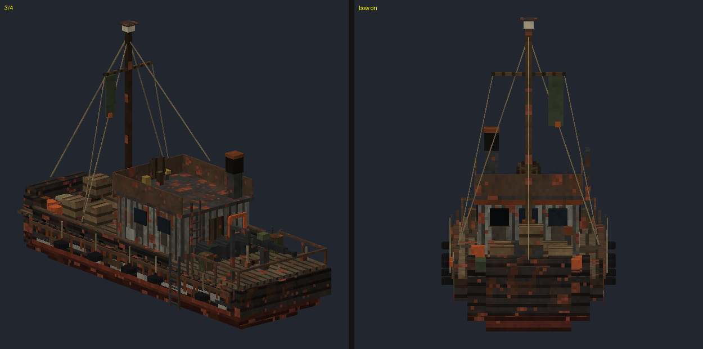
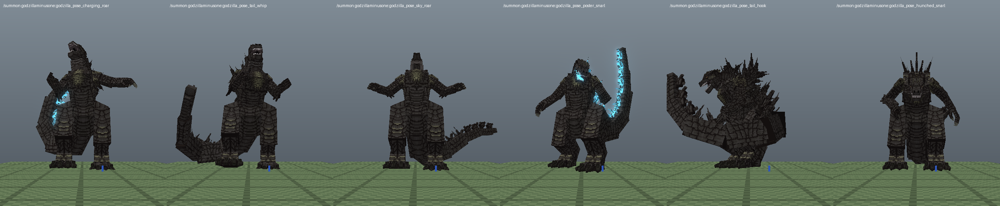
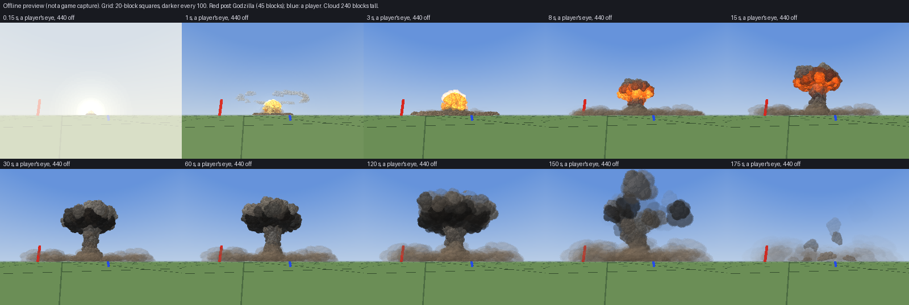
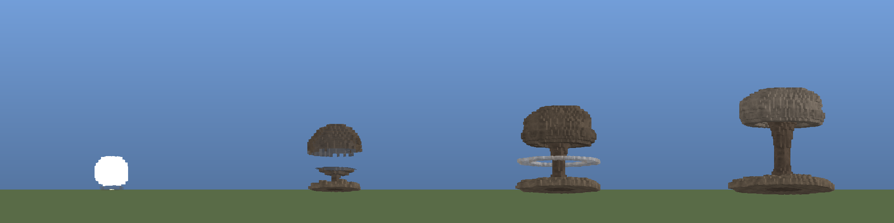

# Godzilla Minus One — Forge 1.20.1

A Minecraft Java Edition (Forge 1.20.1, GeckoLib 4) port of the Bedrock add-on
**"Godzilla Minus One" V3 by GojiDraw**. Godzilla is the add-on's own model, textures and animations, exactly
(scaled up evenly to stand 10 blocks taller), and so are the Shinden, naval mine, sounds and effects. The atomic
blast follows the **Ginza blast in the film**, from the flash to the mushroom cloud breaking up, built from **Alex's
Caves'** mushroom cloud textures. The mod also adds the **Odo Island Monster** (Godzilla's smaller, dinosaur-like
form from the start of the film): Monster122's
**Godzillasaurus** from the "G-1" Bedrock add-on, with its own model and animations. There are also the **Shinsei
Maru**, the film's little minesweeper with its stern machine gun and a hold of naval mines, a **searchlight**, a
**nuclear bomb**, a **remote detonator** for the naval mines, and posed **Godzilla statues** for screenshots and
thumbnails. With **Walkers** or **ReMorphed** installed, you can **play as Godzilla**.


*GojiDraw's Godzilla from the front, side and three-quarters, and charged (his plates up and glowing icy cyan).
Offline renders on a one-block grid (darker lines every 10 blocks); the small blue box is a player, 1.8 blocks
tall.*


*The add-on draws him 6.1x (35.4 blocks tall, 59.3 long); the mod 7.83x, evenly (45.5 tall, 76.1 long).*


*The Odo Island Monster (Monster122's Godzillasaurus, his hide turned grey and brown): front, side and
three-quarters, walking, roaring, and burnt to a crisp by a nuclear bomb. Same grid and player as above.*



*The Shinsei Maru, run down and weather-beaten: rust weeping down her hull, paint flaking, a rust-red waterline,
tyres for fenders, the wheel up on the wheelhouse roof, nets, floats and cages on the foredeck, boarding ladders
port and starboard, a rack of recovered naval mines astern and the Type 93 machine gun on the stern platform.
Offline renders.*




*The thumbnail statues as you see them standing in front of each (they turn to face you): charging roar (its tail
plates aglow), tail whip, roar to the sky, the 70th anniversary poster (mouth and every plate aglow) and the tail
hook. Offline renders (tools/preview_poses.py) on a one-block grid with a player.*



*The atomic blast at the default settings, seen from 440 blocks away: the flash whiting out the view (0.15 s); the
fireball, with the ring of mist racing out through the air (1 s) and the dust wave rolling out over the ground (3 s);
the column rising under it as it spreads into the cap, glowing only low down (8 and 15 s); the full-grown cloud,
its fire out (30 and 60 s); breaking up, the cap broadening and thinning from its edges (120 and 150 s); the last
scattered smoke and ground haze (175 s).*



*The same at 0.15, 2, 8, 20, 60, 135 and 172 s, from the side at eye level 760 blocks off, a player's eye 440 off,
three-quarters from 260 up, from below near ground zero and from 620 up. Both are offline renders of the same cloud
(tools/preview_blast.py, not game captures), over 20-block squares; the red post is Godzilla's height (45 blocks),
the blue one a player.*

## Requirements

- Minecraft 1.20.1 with Forge 47.x
- [GeckoLib](https://www.curseforge.com/minecraft/mc-mods/geckolib) 4.x for 1.20.1 (4.8.4 tested against)
- Optional: [AttributeFix](https://www.curseforge.com/minecraft/mc-mods/attributefix), only if you raise
  Godzilla's max health above 1024 in the config
- Optional: [Walkers](https://www.curseforge.com/minecraft/mc-mods/woodwalkers) (5.8.x, with its library
  CraftedCore) and, if you like, [ReMorphed](https://www.curseforge.com/minecraft/mc-mods/remorphed) (4.2.x), to
  play as Godzilla (see **Playing as Godzilla**). Neither is needed otherwise.

## What's in it

| Add-on content | In this mod |
| --- | --- |
| `goji:gojira` (+ dead / spawn stages) | **Godzilla** (`godzillaminusone:godzilla`), one entity with emerge → roar → active → collapse → dead → regenerate phases |
| `goji:kyushu_j7w1` | **Kyushu J7W1 Shinden**, a fighter you can fly |
| `goji:torrid` | **Torrid**, the Shinden's cannons: hold right-click while flying it |
| `goji:mine_spawn` / `goji:mine` | **Naval Mine**, craftable (4 netherite ingots, 4 netherite blocks, TNT in the middle), and a **Remote Detonator** for it |
| `goji:nuclear_hole` | The crater and blast wave left by the atomic breath |
| Nuclear explosion particles | The atomic blast's flash, fireball, dust wave and mushroom cloud (`client/render/NuclearCloud.java`, after the film's Ginza blast), its sparks and the black rain |
| Particles, camera shakes, custom boss bar | Recreated in Java (see `client/`); the fade to black is a blur instead |
| *(from Monster122's G-1 add-on)* | **Odo Island Monster** (`godzillaminusone:odo_island_monster`), with its spawn egg |
| *(new, from the film)* | **Shinsei Maru**, the minesweeper: a boat with a stern machine gun and a hold of naval mines |
| *(new)* | **Searchlight**, a mountable WWII searchlight |
| *(new)* | **Nuclear Bomb**, called in from the sky |
| *(new)* | **Godzilla statues** in five poses, `/summon` only |

### Godzilla

- GojiDraw's model, 45.5 blocks tall, 21.7 wide and 76 long (tail and dorsal plates included). Spawns from
  his egg by rising out of the ground and roaring, then becomes active (with the add-on's boss bar).
- **His roar carries for 3000 blocks**: faint that far off, louder at 2000, louder again at 1000, and so on as
  you get closer (loud, but not painful in headphones). **From 200 blocks away you hear a distant roar** instead
  (two recordings, taking turns from one roar to the next); closer in, the roar itself. Each listener gets exactly
  one of the two, picked by their own distance, so they never play over each other.
- **Radiation aura**: anything within 16 blocks gets "RADIATION POISONING" and Wither.
- Every footfall shakes the camera, hurts everything near him and **crushes a footprint** of rubble into the
  ground. He smashes through blocks (needs `mobGriefing`), and **buildings fall over** as he wades through them
  or swipes at them: the walls high up beside him topple as falling blocks, thrown the way he's going (or away
  from his swipe), and come crashing down; what's below them breaks apart.
- **He knocks down tall buildings**: when there's nothing in sight for him to kill and he sees anything built
  standing **half his height (23 blocks: he really stands ~45 tall) or more** above the ground (within 64 blocks),
  he goes over and swipes at it, ten layers at a time (the top of it toppling away from him), until it's down to
  **a quarter of his height (11 blocks)**, then leaves it alone, and **leaves buildings alone for 20 seconds**
  (`demolitionIntervalSeconds`) before he picks the next. Trees and hills don't count. A mob turning up sends him
  after it instead. (This is separate from what he breaks just by walking into it or treading on it.)
- **He roars every 2 minutes** (stopping where he is to do it); set how often in the config screen.
- Up close he attacks in a combo: a **claw swipe with each hand**, then a **heavy spin** of his whole body with
  the tail sweeping round him and **snapping like a whip**. He bites at things above him, stomps on things
  under his feet, and swings the tail round at anything behind him. His **bite** is a real bite now (head rearing
  back, jaws gaping, then a lunge and a snap), with its own sound as the jaws close.
- For the first **2 to 3 minutes after he appears** he can't use his atomic breath yet.
- **He only uses his atomic breath on a target 75 blocks away or more** (`minTargetDistance`); anything closer he
  walks up to and fights in melee. This is checked when he decides to start a charge: a charge under way is never
  called off. (Wandering about, with no target, he doesn't breathe at all.)
- With a target that far off he **charges his atomic breath**: the dorsal plates light up blue one by one from the tail to
  the neck as they punch up, mobs freeze in fear, he breathes in for 4 seconds (the in-breath sound lasts
  exactly as long), the inside of his mouth glowing blue, faintly at first and ever brighter until it blazes just as
  he fires, then rears his head up above his chest and fires, **his head turned to whatever he's firing at**: left
  or right, up at planes, down at things close by (his body following round more slowly). The
  plates **slam back down the instant the beam appears**. The beam pours out between his open jaws, which blaze blue
  while it lasts. **Two seconds after the beam lands**, a **nuclear blast** goes off there: it kills everything
  around it and blasts out a **large crater** (about 96 blocks across and 20 deep) at once, and you see it unfold as in the film's Ginza scene (see
  **The atomic blast** below). Everyone nearby sees a blur, then black rain falls around ground zero (just
  particles: the weather isn't changed).
- **Out to 100 blocks the world is left in ruins**: whatever is still standing (trees, buildings, villages) is
  burnt and broken: leaves burnt away and trunks charred black, crops and grass dead, windows blown in, wooden walls
  and roofs holed and charred, stonework cracked and holed, fires here and there (less damage further out). The
  radius is `ruinRadius` in the config.
- The blast **levels the land for 60 blocks around**: everything above **Y 65** (trees, grass, buildings,
  hills) is obliterated, sweeping outwards from ground zero, and **nothing drops**. Seas and rivers stay. Parts of
  the area that aren't loaded yet are flattened when they load. Radius and height are in the config.
- As the beam dies out he **roars, the whole roar** (5.5 seconds), then he's back on his feet: jaw shut, back to his
  normal stance, walking and fighting again. (He used to freeze there, mouth open: the roar he'd have let out on
  his own during the charge followed straight after. It no longer does.)
- He then needs **3 minutes to recharge** before the next breath (change it in the config screen).
- The breath **burns his own mouth**: the flesh round it is left raw, blistered and glowing, smoking and
  spitting embers, then tears and knits back together over 40 seconds.
- **A plane in the air always comes first**: if someone is flying a Shinden, he goes after it.
- He regenerates while calm and likes to wander into water. In shallow water he walks along the bottom; in deep
  water he **swims at the surface** with his dorsal plates out of the water, runs down boats and bites at them
  (a new swimming bite, he doesn't stand up). Every 10 seconds his **head comes up out of the water** and
  glares around for 4 seconds, then sinks back under.
- **In the water, the Shinsei Maru is his main focus**: while he's swimming (or wading) and she's afloat within
  his reach, he forgets everything else and goes after her, for her helmsman first, then her gunner, and keeps
  after her even with nobody aboard. One bite or swipe wrecks her.
- **Only naval mines hurt him** (as in the add-on), each taking about 10% of his health and stunning him.
  At zero health he collapses (5 seconds), lies defeated for **15 seconds** (`downedSeconds`, counted from the end of
  his collapse), then regenerates and rises again.
- **The one exception: his burnt face.** While his mouth is still raw from his atomic breath (the 40 seconds it
  takes to heal), a Shinden flown **straight into his face** at full speed takes **all his health**: he collapses as
  when the mines bring him down. Only his face counts (not his chest, tail or legs), and not once it has healed.

### Kyushu J7W1 Shinden

- Right-click to climb in. **The view switches to third person**, pulled back 11 blocks so the whole plane (13
  blocks wingspan) is in frame, and back to first person when you get out (F5 turns the view round to the front
  and back while you fly).
  **W** accelerates, **S** brakes, the mouse steers: look up to climb, down to dive.
  The plane noses up as it climbs and down as it dives, stays level in level flight, and banks into turns.
- **Hold Left Control to look around** (Free Look, rebindable): the plane flies on the way it was heading while you
  look; let go and your view swings smoothly back to the nose before the mouse steers again (no sudden turn). The
  cannons fire along the nose.
- **Its engine is silent while it sits still on the ground**, even with you in it; you hear it once it's rolling or
  in the air.
- You stay in the cockpit however it pitches and banks. **Hold right-click to fire the plane's cannons**
  straight ahead: they keep firing for as long as you hold it, five rounds a second (a bang and a flash from
  each gun every round), whatever you're holding.
- Pilots have the add-on's "plot armour": Godzilla's blasts barely scratch them.
- Fly within 15 blocks of Godzilla and the plane detonates like a naval mine (the film's ending), and you bail
  out with Slow Falling as a parachute. **Burnt from his breath, he can be brought down by flying straight into his
  face** (see Godzilla, above).
- Crash into something at (near) full speed and it explodes on impact as big as **3 TNT** (a block-breaking
  explosion of power 12). You bail out and the explosion spares you. The blocks it blows up simply vanish:
  nothing drops, so the game doesn't slow down under a heap of items.
- Hit it like a boat: it rocks, and a few hits knock it back into its item (one hit in creative).
- **Multiplayer servers**: set `allow-flight=true` in `server.properties`, or flying players get kicked.

### Naval Mine

- Floats on water; can be leashed and towed.
- Hitting it by hand (or with a tool) doesn't hurt it: it rocks with a clank, and **four hits knock it loose**
  into its item so you can pick it back up (one hit in creative).
- Anything else that damages it sets it off: arrows, explosions, fire, Godzilla's footsteps, his radiation.
- **Found in chests**: end city treasure (25% of chests), nether fortress (15%) and ancient city (20%), on top of
  their usual loot (a global loot modifier: nothing is taken out). A chest that has them holds **1 to 3**, 3 the
  rarest: 1 six times in ten, 2 three times, 3 once (so a 3 is in 2.5% of end city chests, 1.5% of fortress chests
  and 2% of ancient city chests). The chances and the 6:3:1 weights are in
  `data/godzillaminusone/loot_modifiers/*.json` (a datapack can override them). It can still be crafted.
- **Remote Detonator** (a lightning rod on top as the antenna / iron ingot, redstone, iron ingot / iron ingot,
  stone button, iron ingot): point it at a naval mine up to 160 blocks away and right-click, and it goes off.
  Blast radius 30: stand well back.

### Odo Island Monster

- Godzilla's first form from Odo Island: Monster122's Godzillasaurus, **14 blocks tall** and 29 long, 600
  health. Crouched and leaning forward on huge bent legs, head held low in front on a thick curved neck, clawed
  hands hanging, a long tail behind, jagged plates rising high over his back, and a grey and brown scaly hide.
  His walk, roar, two bites (one with a swipe of his arm), stomp and burnt pose are the add-on's animations.
- Left alone he wanders and ignores you, but get within about 16 blocks and he **charges**: he runs you down,
  crashing through trees and fences, and **bites** or **stomps** you.
- **Lit by a searchlight someone is working, he goes for the light**: he turns to stare straight into it and
  roars, then charges it, bites or stomps it to pieces (glass shattering, the iron frame clanging down), and
  comes straight for whoever was working it, in a frenzy. If the searchlight is up on or inside a building, he
  **tears through the building** to get at it (whatever it's made of), and brings down what it stands on, the light
  coming down with it. Blocked short of it (a wall, a building, a cliff), he **tears through whatever's in the way**
  from wherever he's stuck; if after 30 seconds nothing he can break gets him to it (up a natural cliff, say), he
  gives up on the light and goes for whoever was working it instead, so he never stands stuck. A player who comes
  close (12 blocks) while he's after the light draws him off it, onto them. A searchlight sweeping on its own
  doesn't bother him.
- **Spotted, he goes into a frenzy**: seen by a player (a player looking at him
  from up to 64 blocks away, or one he can see within 32), or hurt by one, he roars and comes for them: a third
  faster, biting and stomping 60% harder and twice as often, crashing through wooden doors too, and he
  doesn't let up for 90 seconds, even when they're out of sight.
- **His sounds** (each played once per event, from the server so everyone in range hears the right one): his roar
  (`odo.roar`), his shriek when a searchlight catches him (`odo.spotted`, in place of that roar), his arrival cry when
  he spawns (`odo.spawn`, heard ~64 blocks round, on its own: the old vanilla-timed growl straight after spawning is
  gone, and he doesn't roar over it for its first 4 seconds), his bite (`odo.bite`, as the jaws close), his cry when the nuclear
  bomb burns him (`odo.nuked`), and a distant roar (`odo.roar_far`) for anyone 100 blocks or more away when he roars
  or shrieks (out to 400 blocks).
- His spawn egg is an ordinary vanilla-style egg in his grey-brown and dark brown.
- **Nuke him** with a Nuclear Bomb and he doesn't die: he collapses, **burnt to a crisp**, the embers in his
  hide slowly going out. Nothing can hurt him while he lies there. **Three minutes later he rises again as
  Godzilla.** (Godzilla's own atomic breath just kills him.)

### Searchlight

- Crafted from iron ingots, glass, a redstone lamp and iron blocks (iron ingot, glass, iron ingot / iron
  ingot, redstone lamp, iron ingot / three iron blocks). Right-click the ground to set it up facing the way
  you look.
- The beam is a slightly blocky shaft of light: square sections that widen in half-block steps and fade with
  distance, round a soft bright core, with a pool of light picked out block by block where it lands. It's drawn
  after water and ice and never hides them: looking at it over the sea or through ice you no longer see straight
  through to what's under the water. It ends at the surface of water.
- **Left alone it sweeps round on its own**, like the hand of a clock, a full turn every 40 seconds, at the tilt it
  was left at, throwing a white beam.
- Right-click it to sit at it: the lamp turns and tilts with where you look. The beam reaches 160 blocks. Press
  **R** ("Vehicle Action" in Controls) to switch the lamp **off**, and again to switch it on; it stays as you left
  it. It widens as it goes and lights up **a wide pool** where it lands: a bright
  spot 10 to 25 blocks across (wider the further it reaches) on whatever it hits, lit by a ring of light
  sources up to 7 blocks out. Sneak to get off.
- An Odo Island Monster caught in the beam while you're working it comes for the light, smashes it and then
  comes for you (see above).
- Hit it like a boat to knock it back into its item.

### Shinsei Maru

- The film's small, run-down, weather-beaten minesweeper, **16.3 blocks long and 5.6 wide**: rust streaks, flaking
  paint, patched planks, tyres for fenders, nets and floats heaped on the foredeck. Crafted from a boat with five dark oak
  planks under it and an iron ingot on top (iron ingot in the top middle / planks, boat, planks / three planks).
  Use it on water to put her in, facing the way you look.
- **You can walk on all her decks** without falling through: the forecastle, the main deck and the side decks round
  the wheelhouse, the wheelhouse roof (the helm) and the stern platform. They're tiled with small solid sections that
  overlap, so there's deck under you whichever way she's heading and while she turns (checked at 16 headings by the
  game tests). Standing on her, you're carried along as she moves and turns; if she moves into you, you're pushed out
  (onto her deck if you're nearly up there).
- **Boarding ladders** on both sides, just aft of the wheelhouse, and one up the back of the wheelhouse to its roof
  and the wheel: walk or swim into one to climb it (sneak to hold on).
- **Two seats.** Right-click her **stern** (the gun platform) to take the **gunner's seat** at the **Type 93 13 mm
  machine gun**; right-click her **anywhere else** to take the **wheel**, up on the wheelhouse roof, and the mines.
  Only the gunner works the gun. **The crew stand**: the gunner on the stern platform behind the gun, the helmsman at
  the wheel. At the wheel: **W** ahead, **S** astern, **A/D** steer; she moves the way her bow points. Flat out she's
  **as fast as Godzilla swims** after something (8.4 blocks a second).
- **The gun points aft** and swings 135 degrees either way: the gunner aims it by looking, and it's **automatic**:
  hold right-click and it keeps firing (five rounds a second). A round **sets off a naval mine** it hits.
- **Naval mines**: sneak and right-click her to open her **hold** (9 slots, naval mines only), or right-click her
  with a naval mine in hand to load it. Up to three show in the rack on deck. The helmsman presses **R** ("Vehicle
  Action" in Controls) to **drop one over the stern**: it floats there, and goes off when Godzilla comes near
  (his radiation sets it off), like the film's mine dragged into his mouth.
- **She sits steady on the water**: no bobbing of her own. Physics Mod's ocean waves are drawn on its own (client)
  side and it has no API another mod can read their height from, so she can't follow them; rather than bob out of
  step with them she keeps still, with or without it.
- **Her motor**: under way you hear her old diesel chug, quietly, a little louder and higher as she picks up speed;
  it fades in as she gets going and out as she stops, one seamless loop per boat (a sound made for this mod by
  `tools/make_sounds.py`, not a recording).
- Hit her like a boat to knock her back into her item, mines and all (one hit in creative). Explosions and
  Godzilla smash her to matchwood, throwing the crew in the water.

### Nuclear Bomb

- Crafted from netherite ingots in the corners, TNT on the sides and a nether star in the middle.
- Use it while looking at a spot up to 256 blocks away: a bomb is dropped from high above it, marked by a red
  flare and a column of smoke. Everyone nearby gets a countdown and hears an **air-raid siren**, the only
  sound until it lands; it **falls for 20 seconds**, then goes off like Godzilla's atomic blast (same kill radius, radiation, crater and
  mushroom cloud; see the atomic blast options in the config). It goes off early if it hits something on the
  way down, such as a roof. Stand well back: the kill radius is 64 blocks by default.

### The atomic blast

Godzilla's atomic breath landing and the nuclear bomb make the same blast. Its damage, crater and flattening all
happen at the moment of impact. What you see unfolds like the Ginza blast in the film, anchored to ground zero,
the same size seen from anywhere (whatever Godzilla's size):

| Stage | Default timing (from the impact) | What you see |
| --- | --- | --- |
| Flash | 0 to 1.5 s | A white-hot core swelling in a moment into a pale yellow glare that whites out your view, then dying away; the sky lights up like lightning. |
| Fireball | 0 to 4 s | A ragged, blazing ball, white-hot, then yellow and orange, swelling to about 70 blocks and starting to rise. A ring of mist races out through the air and is gone within 3 seconds. |
| Dust wave | 0 to 8 s | A wall of dust rolling out over the ground (over hills and into valleys), fast, then slowing, out to about 230 blocks, leaving a haze behind it as it passes. |
| Column | from 1 s | As the glare fades, a thick, lumpy column of smoke rises under the fireball, its foot lost in the dust churned up round it. |
| Cap | up to 30 s | The fireball spreads into a broad, heavy cap, rolling over on itself: charcoal, grey and dirty brown, lighter billows on top, dark underneath, glowing orange only low down while it's hot. About 250 blocks tall and 290 across, its stem about 70 thick. |
| Cooling | glow out by 30 s | The fire inside dies out well before the smoke. Black rain falls from the cloud from about 6 seconds after the blast, for as long as it towers overhead. |
| Mature cloud | 30 to 90 s | It towers over ground zero, still slowly rising, spreading and rolling over. |
| Breaking up | 90 to 180 s | The cap broadens and softens, its outer billows thin away first, then its heart and the stem break up and drift, leaving scattered smoke and ground haze that fade last. (Longer than in the film, so it can be seen.) |

All of these are settings (see **Configuration**). The timings are a proposal for the film's sequence at a playable
pace, not measured from the film. You see the blast from up to 1024 blocks away and as far as your view reaches
(four times your render distance), through the fog.

### Godzilla statues (for thumbnails)

Godzilla frozen in poses from the film's posters. They never spawn on their own and have no spawn egg: make
them with `/summon`. A new statue turns to face you; it holds still (in mid-air too), does nothing and can't be
hurt. Hit it in creative mode, or `/kill` it, to remove it.

| Pose | Command |
| --- | --- |
| Roaring, one arm flung out, the glowing tail raised high round his side | `/summon godzillaminusone:godzilla_pose_charging_roar` |
| The tail swung round in front of him, its tip rising | `/summon godzillaminusone:godzilla_pose_tail_whip` |
| Roaring up at the sky, arms spread | `/summon godzillaminusone:godzilla_pose_sky_roar` |
| The 70th anniversary poster: braced in a low crouch, snarling down at you with his mouth lit blue, his left hand reaching forward with its claws turned up, every dorsal plate aglow and the tail rising behind him in a tall J | `/summon godzillaminusone:godzilla_pose_poster_snarl` |
| Turned three-quarters to your left, knees bent, growling, the near arm in front of his chest, the tail swept round in front of his legs and curling up in a broad open hook (unlit) | `/summon godzillaminusone:godzilla_pose_tail_hook` |
| Hunched snarl: almost square on, leaning forward, shoulders hunched up and forward and his head lowered between them, snout a little down, jaw slightly open; his right arm (on your left) bent with the claw forward at the bottom of his chest, his left (on your right) lower and further out with the claw open and angled down; left foot forward, knees bent (unlit) | `/summon godzillaminusone:godzilla_pose_hunched_snarl` |

**Screenshotting the hunched snarl** (`docs/hunched_snarl_preview.png` is the model as the mod draws it, from the
mod's files, and the in-game check below takes the same picture in the game): below his chest, almost square on,
looking up, tight on his head, shoulders, chest and both claws. In creative mode, on open flat ground:

1. `/summon godzillaminusone:godzilla_pose_hunched_snarl ~ ~ ~ {Rotation:[0f,0f]}` (he faces south)
2. Double-tap jump to fly, then, without moving from where you summoned him:
   `/tp @s ~-2.4 ~13.1 ~35.2 facing ~ ~29.8 ~` (your eyes 35 blocks in front of him, 15 up, a little to his right,
   looking at the middle of his chest)
3. Options: FOV **45**, and in Accessibility Settings **FOV Effects 0%** (flying widens the view otherwise); a 16:9
   window (1280×720, say); **F1** to hide the HUD, **F2** for the screenshot.

He holds perfectly still (no idle, no AI, no head turning), so you can take your time.

To face a statue a given way, give it a rotation, e.g. `/summon godzillaminusone:godzilla_pose_sky_roar ~ ~ ~ {Rotation:[180f,0f]}`.
The poster snarl and the tail hook already stand turned within themselves (30 and 55 degrees), so that facing you they show you
the poster's angle: get down low in front of them and look up, as the posters' cameras do. Their feet, the poster
statue's fingers and tail tip, and the tail hook's far arm and where its tail joins him aren't in the pictures,
so those are made up to match.

### Playing as Godzilla (Walkers / ReMorphed)

With [Walkers](https://www.curseforge.com/minecraft/mc-mods/woodwalkers) installed you can take Godzilla's shape:

- **Unlocking him**: with Walkers, hold its unlock key (**U**) while looking at him, or use
  `/walkers change2ndShape <player> godzillaminusone:godzilla` (then **G** switches to him and back); with
  ReMorphed, **bringing him down** counts as killing him (he never really dies) and unlocks his shape, or use
  `/remorphed addShape <player> godzillaminusone:godzilla`, then pick him from ReMorphed's menu.
- Walking as him, you **break through what's built in your way** (as he does: not hills and cliffs) and **crush a
  footprint** where each foot comes down (`playerGodzillaBreaksBlocks`, `playerGodzillaFootprints`; also needs
  `breaksBlocks`, the `mobGriefing` gamerule and being allowed to build there). Charging the breath, his head follows
  where you look.
- As him you're always in **third person** (the camera pulled far enough back to show all of him; F5 still turns
  it round to face you), back to first person when you change back.
- As him, a small list of his moves and their keys sits in the **top left corner** of the screen:
  - **Z: Tail Whip**, a spin of his whole body, the tail sweeping round twice,
  - **H: Scratch**, a claw swipe (right, then left),
  - **J: Bite**: his bite (rear back, lunge, jaws snap shut), with its sound (a swimming bite in the water),
  - **K: Roar**: weakens and slows everything within 48 blocks for 10 seconds,
  - **B: Atomic Breath**: the full charge, beam and nuclear blast where it lands (flattening too, with
    `mobGriefing`), then a **3 minute** recharge, counted down beside it (change it in the config: it's his
    breath interval). You stand rooted from the start of the charge until the roar after the beam is over, then
    you're free to move again.
  All five are in Controls under Godzilla Minus One, to rebind.
- Moves are seen by everyone near you (multiplayer). Whatever interrupts you (changing back, dying, respawning,
  changing dimension, logging out) frees you: you're never left rooted.
- Walkers' own keys are G, U, V and R (its shape's ability). **R is also this mod's "Vehicle Action"** (the Shinsei
  Maru's mines, the searchlight's lamp); rebind one of them if you use both.

### Playing as the Odo Island Monster (Walkers / ReMorphed)

Take his shape as you would Godzilla's (`godzillaminusone:odo_island_monster`):

- **Hold Left Control to run** ("Odo Island Monster: Run", rebindable): **6 blocks a second** on level ground
  (`playerOdoRunSpeed`); his shape runs. The key only counts while you're him (and not riding anything), so it
  never clashes with the Shinden's Free Look on the same key.
- **Left click bites** (his bite animation, seen by everyone; the jaws close 0.75 s in, `playerOdoBiteDamage`) instead
  of a punch.

### Physics Mod

**What's real integration and what's this mod's own**: there is no Physics Mod API that this mod calls (its mod id,
`physicsmod`, is only checked to see whether it's installed). Physics Mod turns a block broken the vanilla way
(Minecraft's own breaking, with its break sound and particles) into pieces flying under physics, by itself. This
mod's part:

- **Buildings toppling** is this mod's own simulation: the blocks Godzilla's swipes and his body throw off a building
  fly as vanilla falling blocks and land as rubble (with or without Physics Mod).
- The rest of what he breaks is broken the vanilla way, so Physics Mod can shatter it. **With Physics Mod installed,
  every block he knocks off a building he's demolishing is broken that way**, and the mod adds no particles of its
  own on top (without it, only a share are, to keep it light), so the debris isn't doubled.
- The Shinsei Maru sits steady: Physics Mod's waves can't be read, so she doesn't follow them.
- None of this has been tried in game with Physics Mod itself.

## Configuration

- **In game**: Mods → Godzilla Minus One → Config.
  - **Godzilla Health Bar** turns his health bar at the top of the screen on or off.
  - **Breath: every** sets how long he takes to recharge his atomic breath, from 10 seconds to 10 minutes
    (3 minutes by default).
  - **Roar: every** sets how often he roars on his own, from 30 seconds to 10 minutes, or off (2 minutes).
  - The atomic blast: **Cloud Height** (40 to 600 blocks, 240), **Blast Flash** (how strongly the flash whites out
    your view, 0 to 100%; Minecraft's "Hide Lightning Flashes" option also turns it off), **Cloud Rises**
    (30 seconds), **Cloud Towers** (how long it stays full-grown, 1 minute) and **Cloud Fades** (how long it takes to
    break up, 1 minute 30).

  The health bar and the blast are saved in `config/godzillaminusone-client.toml`, in its `atomicBlast` section,
  which also has `flashSeconds` (1.5), `fireballSeconds` (4), `shockwaveSeconds` (8, the dust wave) and
  `coolingSeconds` (30). The breath and roar intervals are in the gameplay config below, so they apply to worlds
  played on this computer (a server keeps its own). (The cloud's settings have new names, so a client config from
  an earlier version picks up the new defaults.)
- **Gameplay**: `config/godzillaminusone-common.toml`. The add-on's world-ending numbers (2000-block kill
  radius, Wither XXVI) are toned down by default; each option's comment lists the add-on's original value so
  you can restore it. You can also make Godzilla mortal, stop him regenerating, turn off block damage, change
  the atomic breath's crater, ruins and flattening (`craterRadius`, `scorchRadius`, `ruinRadius`, `flattenRadius`, `flattenDownToY`), his first breath's delay
  (`firstBreathMinSeconds`, `firstBreathMaxSeconds`), which buildings he knocks down and how far
  (`demolishFromHeight`, `demolishDownToHeight`: -1, the default, means half and a quarter of his real height, 23
  and 11), how often (`demolitionIntervalSeconds`, 20), or stop him knocking them down at all.

  New in this version, with their defaults:

  | Setting | Section | Default | What it does |
  | --- | --- | --- | --- |
  | `downedSeconds` | `godzilla` | 15 | Seconds he lies defeated, counted from the end of his 5 s collapse, before he regenerates and gets up. |
  | `demolishFromHeight` | `godzilla` | -1 (23) | How tall a building must be for him to demolish it; -1 = half his real height. |
  | `demolishDownToHeight` | `godzilla` | -1 (11) | How tall he leaves it; -1 = a quarter of his real height. |
  | `demolitionIntervalSeconds` | `godzilla` | 20 | Seconds between buildings he picks to demolish. |
  | `minTargetDistance` | `atomic_breath` | 75 | He only starts an atomic breath at a target at least this far away. |
  | `playerGodzillaBreaksBlocks` | `playable` | true | Playing as Godzilla: walking and his blows break what's built. |
  | `playerGodzillaFootprints` | `playable` | true | Playing as Godzilla: strides crush footprints. |
  | `playerOdoRunSpeed` | `playable` | 6.0 | Playing as the Odo: running speed, blocks a second. |
  | `playerOdoBiteDamage` | `playable` | 30 | Playing as the Odo: bite damage. | (The crater, flattening
  and building settings have new names, so a config file from an earlier version picks up the new defaults.)

## Building

```
./gradlew build
```

The jar ends up in `build/libs/`. GitHub Actions builds it on every push (see the *Actions* tab, artifact
`godzillaminusone-jar`) and then runs the server-side game tests (`./gradlew runGameTestServer`, see
`src/main/java/com/npjt25/godzillaminusone/gametest`).

A second job starts the real game client on a virtual display (`xvfb-run ./gradlew runClient -Pshots`, software
OpenGL, no sound device) and plays a script of scenes in a fresh flat creative world
(`client/harness/Scenes.java`): the statue from the poster camera, the Odo Island Monster's spawn sounds, Godzilla's
roar heard from either side of 200 blocks, the searchlight over water and ice (Fancy and Fabulous graphics), walking
the Shinsei Maru's decks and climbing her ladders while she turns, her motor, the Shinden's camera, engine and Free
Look, and Godzilla getting over his breath. Each check is logged as `GMO-CHECK PASS`/`FAIL` (the job fails on any
`FAIL`), and the screenshots are uploaded as the `screenshots` artifact (and printed into the log as base64 JPEG
lines, `GMO-IMG`). The harness does nothing unless the game is started with `-Dgodzillaminusone.shots=true`.

## Re-converting the add-on assets

`tools/convert_addon.py` regenerates everything under `src/main/resources/assets` from the extracted
`.mcaddon` (models, cleaned-up animations, textures split into skins and glow masks, sounds converted to mono Ogg):

```
pip install pillow numpy imageio-ffmpeg
python3 tools/convert_addon.py path/to/extracted/addon
```

Then make Godzilla's burns, edit the animations, and build the rest:

```
python3 tools/godzilla_burns.py         # the burns round his mouth after the beam (on the add-on's texture layout)
python3 tools/edit_animations.py        # in-breath, beam from the mouth, swimming bite and peek, melee combo, statue poses
python3 tools/godzilla_mouth_glow.py    # the glow inside his mouth for the poster statue
python3 tools/make_sounds.py            # the in-breath, the nuclear bomb's air-raid siren, single gunshots (Shinden, Shinsei Maru)
python3 tools/make_odo_model.py "path/to/G-1(RE)"   # the Odo Island Monster, from Monster122's G-1 resource pack (hide greyed)
python3 tools/make_props.py             # the searchlight, nuclear bomb and Shinsei Maru models
python3 tools/make_icons.py             # item icons of the new items
```

```
python3 tools/make_cloud_sprites.py     # the atomic blast's smoke, fire and flash sprites, from Alex's Caves' cloud textures
```

(Alex's Caves' mushroom cloud textures, `tools/reference/alexs_caves/mushroom_cloud*.png`, are its own, unchanged;
the game uses the sprites made from them, `textures/effect/nuclear_cloud.png`.)

Previews without starting the game: `tools/render_preview.py` renders a cube model with its texture (and any
animation frame, optionally on a one-block grid with a player for scale, from a perspective camera with glowing
parts); `tools/preview_poses.py` renders the statues as you see them in game; `tools/preview_blast.py` renders the
atomic blast (`tools/nuclear_cloud_model.py`, the same cloud as the game's `NuclearCloud` and `BlastTimeline`) at
given times and viewpoints.

## Credits

Original Bedrock add-on (models, textures, animations, sounds): **GojiDraw**. The add-on is marked
"Bedrock only"; this port is for personal use. Ask GojiDraw before publishing it anywhere.

The Odo Island Monster is **Monster122**'s Godzillasaurus (model, skins and animations) from the "G-1" Bedrock
add-on.

The atomic blast's mushroom cloud is built from **Alex's Caves**' (by **AlexModGuy**, GNU LGPL): its smoke and fire
sprites are cut from its `mushroom_cloud` and `mushroom_cloud_glow` textures, and it's drawn in layers as its
`MushroomCloudParticle` draws its cloud (the texture, then the glow texture added on while it's hot). Its sequence
and look follow the Ginza blast in *Godzilla Minus One*.

Playing as Godzilla works with **Walkers** and **ReMorphed** by **To_Craft** (MIT licence), through their public
APIs, looked up by name only when they're installed; nothing of theirs is included in this mod.

The new sounds (Godzilla's bite and distant roars; the Odo Island Monster's roar, spotted cry, spawn cry, bite, nuked
cry and distant roar) were supplied with the mod's sound archives (`GodzillaMinusOne sounds`, `Odomonster Sounds`)
by the mod's owner; their original source and licence weren't given with them. They're converted to mono (so they
fade with distance in game), otherwise unchanged. The Shinsei Maru's motor is synthesized by `tools/make_sounds.py`
(no recording: the supplied archives hold only creature sounds).

Godzilla is a trademark of Toho Co., Ltd.
